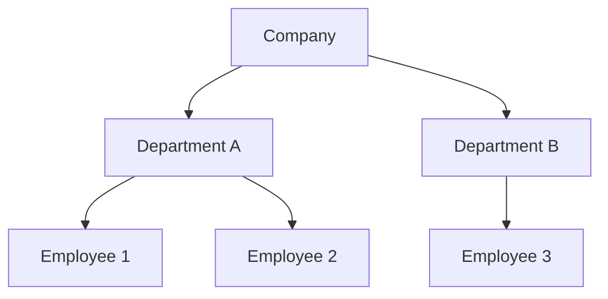
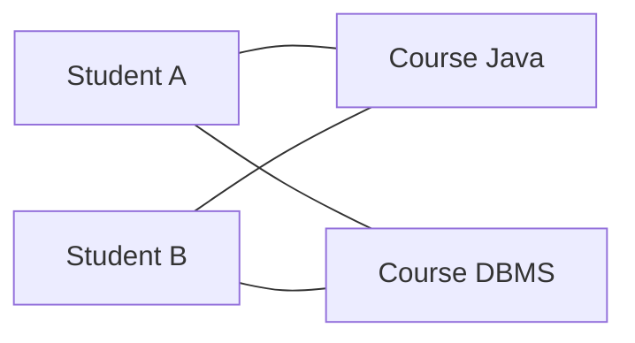
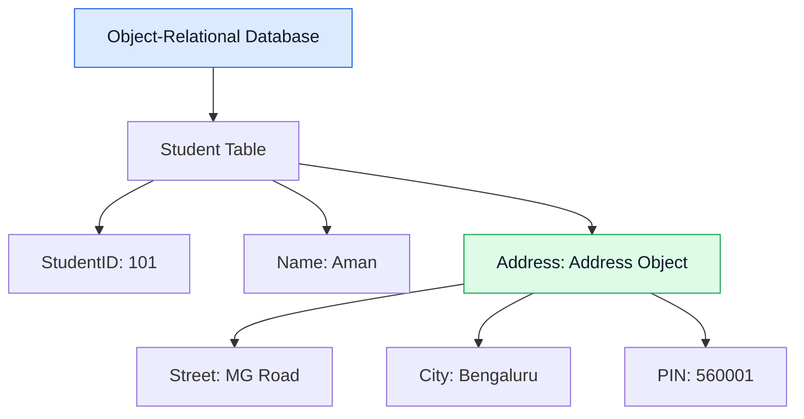
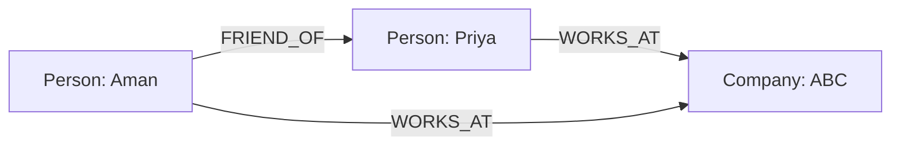
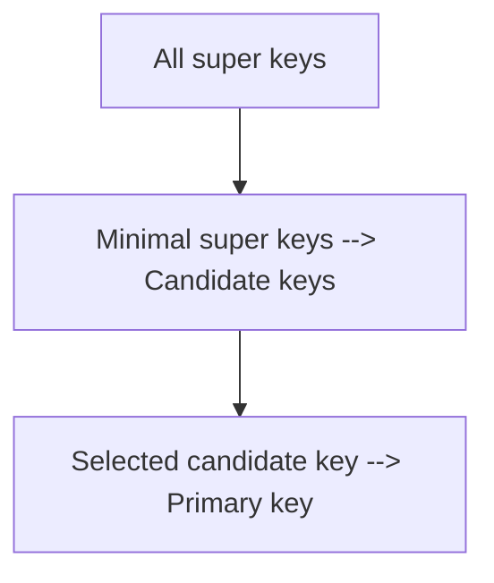
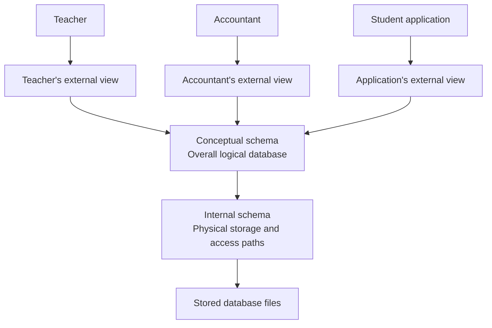
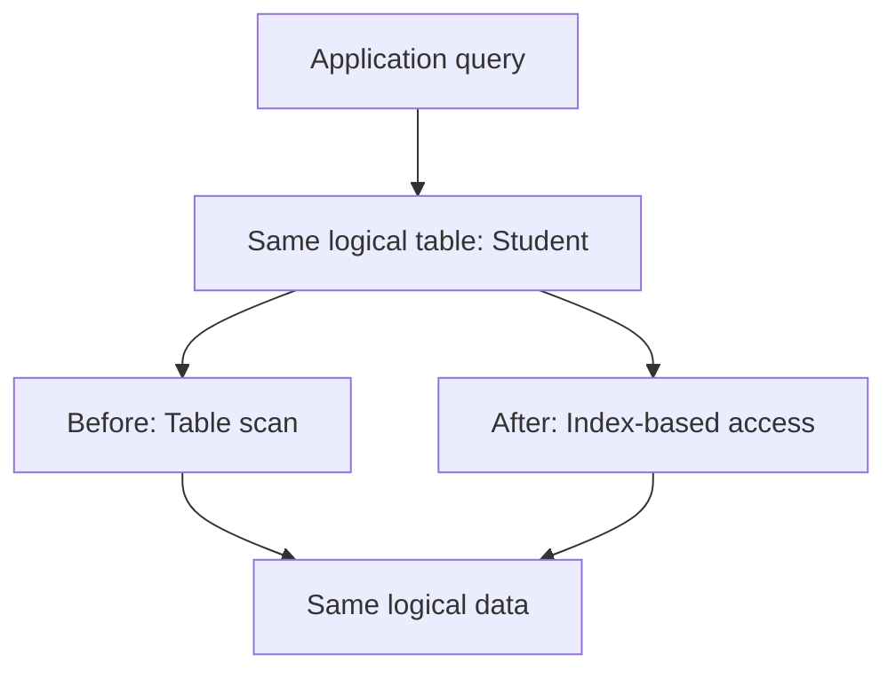
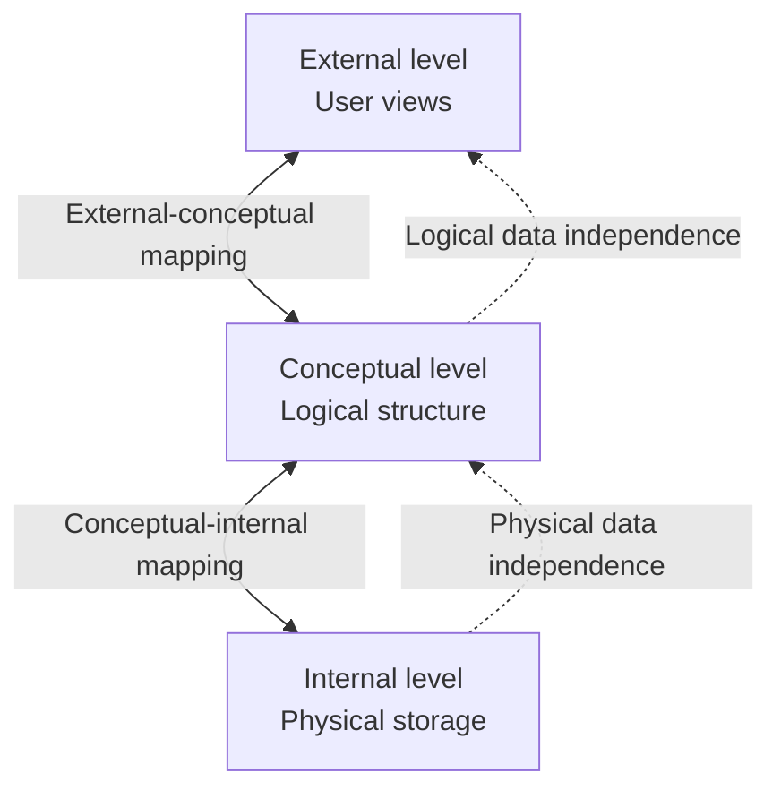
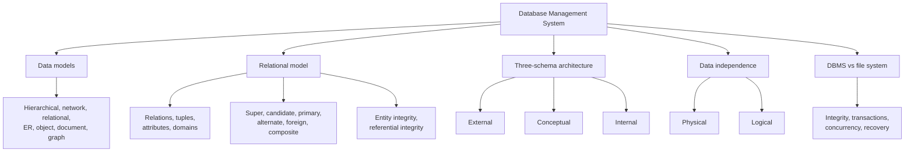

# Relational Model and Integrity 

==Data models==

The major data models are:

1. Hierarchical data model
2. Network data model
3. Relational data model
4. Entity-Relationship (ER) model
5. Object-oriented data model
6. Object-relational data model
7. Document data model
8. Key-value data model
9. Graph data model

==Hierarchical Data Model==

In the hierarchical model, data is organized like a tree.
Each child has only one parent, although a parent can have multiple children.



==Network Data Model==

graph-like structure.
a record can have multiple parent records.



- Supports many-to-many relationships.
- Records can have multiple connections.

==Relational Data Model==

data in tables, also called **relations**.

==Entity-Relationship (ER) Model==

The ER model represents real-world objects and their relationships.
It is mainly used during database design, before converting the design into relational tables.


A student can enroll in many courses, and a course can have many students.

==Object-Oriented Data Model==

The object-oriented data model stores data as objects, similar to object-oriented programming.

An object can contain:
- Attributes or state
- Methods or behavior
- Identity

Example:

```java
class Student {
    int studentId;
    String name;

    void displayDetails() {
        System.out.println(name);
    }
}
```

==Object-Relational Data Model==

The object-relational model combines relational tables with selected object-oriented features, such as user-defined types or complex data types.
It retains the relational foundation while supporting richer data representations.
```sql
CREATE TYPE Address AS (
    street VARCHAR(100),
    city VARCHAR(50),
    pin VARCHAR(10)
);

CREATE TABLE Student (
    student_id INT PRIMARY KEY,
    name VARCHAR(100),
    address Address
);
```


==Document Data Model==

Data is stored as documents, commonly in JSON-like formats.

Example:

```json
{
  "studentId": 101,
  "name": "Aman",
  "skills": ["Java", "SQL", "Python"]
}
```

A document may contain nested objects and arrays.

**Example database:** MongoDB.
example -: reddit threaded comment section

==Key-Value Data Model==

Data is stored as key-value pairs.

Example:

```text
"user:101" -> "Aman"
"user:102" -> "Priya"
```

A key identifies its associated value.
**Example database:** Redis.
Common uses include caching, session storage, and fast key-based lookups.

==Graph Data Model==

Data is represented using nodes and edges.

- Node: An entity.
- Edge: A relationship.
- Properties: Information associated with nodes or edges.



Graph databases are useful for social networks, recommendation systems, and relationship-heavy data.

**Example database:** Neo4j.

---
---

==Relations, Tuples, Attributes, and Domains==

==Relation==

A **relation** is a set of tuples defined over a collection of attributes.
In practical terms, a relation is commonly represented as a table.

Consider:

**Student**

| StudentID | Name | Age | Department |
|---:|---|---:|---|
| 101 | Aman | 21 | CSE |
| 102 | Priya | 22 | ECE |
| 103 | Rahul | 20 | CSE |

The entire Student table represents a relation.
duplicate tuples are not allowed.

==Tuple==

A **tuple** is one complete record in a relation.

For example:

```text
(101, Aman, 21, CSE)
```

This tuple represents one student.

In simple language:

- Relation = Entire table
- Tuple = One row

A tuple contains one value for each attribute, assuming the relation has a fixed set of attributes (not fixed set of attributes -> use  mongodb kindda lol).
domain is set of values permitted each attribute can take

==Degree and Cardinality==

**Degree:** Number of attributes (columns) in a relation.
**Cardinality:** Number of tuples (rows) in a relation.

Consider:

| StudentID | Name | Age |
|---:|---|---:|
| 101 | Aman | 21 |
| 102 | Priya | 22 |
| 103 | Rahul | 20 |
| 104 | Neha | 21 |

Here:
- Degree = 3
- Cardinality = 4

==Relation Schema vs Relation Instance==

relation schema (table schema)
Example:

```text
Student(StudentID, Name, Age, Department)
```

It specifies:
- The relation name
- The attributes
- Their associated domains and constraints

relation instance
The instance is the actual set of tuples stored at a particular time.
Example:

| StudentID | Name | Age | Department |
|---:|---|---:|---|
| 101 | Aman | 21 | CSE |
| 102 | Priya | 22 | ECE |

If we insert another student, the instance changes, but the schema may remain unchanged.

==Properties of Relations in the Relational Model==

A classical relation has the following properties:

1. Each relation has a distinct name within its relevant schema.
2. Each attribute has a distinct name within that relation.
3. Each tuple contains a value for every attribute.
4. Each attribute's values come from its domain.
5. A tuple appears at most once in a mathematical relation.
6. The order of tuples does not matter.
7. The order of attributes does not define the meaning of the relation.

SQL tables have practical differences from the mathematical model. For example, SQL permits duplicate rows unless constrained, and SQL supports `NULL`, which represents missing, unknown, or inapplicable information depending on the situation.

---
---
==Keys in DBMS==

A **key** is an attribute or a set of attributes used to identify records (rows) because its unique.

Keys help us:
- Identify a particular row.
- Prevent unwanted duplicates.
- Connect related tables.
- Enforce data integrity.

Consider these relations.

**Student**

| StudentID | Email | Name |
|---:|---|---|
| 101 | aman@example.com | Aman |
| 102 | priya@example.com | Priya |
| 103 | rahul@example.com | Rahul |

**Enrollment**

| EnrollmentID | StudentID | CourseID |
|---:|---:|---:|
| 1 | 101 | C1 |
| 2 | 101 | C2 |
| 3 | 102 | C1 |

We will use these tables to understand the different keys.

==Super Key==

A **super key** is any set of one or more attributes that uniquely identifies every tuple in a relation.
Suppose StudentID is unique.
Then all the following can be super keys:

- `{StudentID}`
- `{StudentID, Name}`
- `{StudentID, Email}`
- `{StudentID, Name, Email}`

Because StudentID alone uniquely identifies each student. Adding more attributes does not remove that uniqueness.
However, `{Name}` is not necessarily a super key because two students can have the same name.
A super key may contain unnecessary attributes.
For example:

```text
{StudentID, Name}
```

is a super key, but Name is not needed to uniquely identify the student.

==Candidate Key==

A **candidate key** is a minimal super key.
Minimal means that no attribute can be removed from the key without losing its uniqueness.
Suppose both StudentID and Email are individually unique and neither can be null under the chosen design.

Then:

```text
{StudentID}
{Email}
```

are candidate keys.

But:

```text
{StudentID, Name}
```

is not a candidate key because StudentID alone already uniquely identifies the student.
A relation can have multiple candidate keys.
Each candidate key is a minimal way to identify a tuple.

==Primary Key==

A **primary key** is the candidate key selected as the main identifier for a relation.

==Alternate Key==

An **alternate key** is a candidate key that was not selected as the primary key.

In our example:
- StudentID = Primary key
- Email = Alternate key
Both uniquely identify students, but only StudentID is designated as the primary key.

==Foreign Key==

A **foreign key** is an attribute or set of attributes in one relation that references a candidate key, commonly the primary key, of another relation.
Consider:


if studentID is FK in Enrollment table then there should be a row exist in the Student table with PK as studentID

==🔴What happens if a referenced student is deleted?==
The result depends on the foreign key's configured action.

Common actions include:

- `RESTRICT` or `NO ACTION`: Prevent deletion while dependent rows exist, subject to database-specific timing rules.
- `CASCADE`: Delete referencing rows when the referenced row is deleted.
- `SET NULL`: Set the referencing columns to `NULL` when permitted.
- `SET DEFAULT`: Set referencing columns to their configured defaults where supported.

Example:

```sql
FOREIGN KEY (StudentID)
    REFERENCES Student(StudentID)
    ON DELETE CASCADE
```

This allows dependent enrollment rows to be deleted automatically when their student is deleted.

==Composite Key==

A **composite key** contains two or more attributes.

Suppose a student can enroll in several courses, but only once in each course.

The combination of StudentID and CourseID can identify an enrollment:

```text
(StudentID, CourseID)
```

Example:

| StudentID | CourseID |
|---:|---|
| 101 | C1 |
| 101 | C2 |
| 102 | C1 |

Here neither StudentID nor CourseID alone uniquely identifies every enrollment, but their combination does.

SQL example:

```sql
CREATE TABLE Enrollment (
    StudentID INT,
    CourseID VARCHAR(20),
    PRIMARY KEY (StudentID, CourseID)
);
```

==Natural Key and Surrogate Key==

==🔴Natural key==

A natural key is based on an attribute that already has meaning in the real world.
Examples:
- A government-issued identifier, when appropriate and legally permitted
- An official product code
- A unique email address, if the business rules guarantee its uniqueness

 ==🔴Surrogate key==

A surrogate key is an artificial identifier generated for database use.

Examples:
- Auto-incrementing integer
- UUID

```sql
CREATE TABLE Product (
    ProductID BIGINT PRIMARY KEY,
    ProductCode VARCHAR(50) UNIQUE NOT NULL,
    ProductName VARCHAR(100) NOT NULL
);
```

Here ProductID is a possible surrogate key, while ProductCode is a natural candidate key if it is guaranteed to be unique.

==Relationship between the keys==



---
---

==Entity Integrity and Referential Integrity==

==Entity Integrity==

primary key has attributes -> a1, a2, a3
none of these can be null (because pk is selected from candidate key and candidate key is already minimal super key means removing one more attribute can result in duplication)

==Referential Integrity==

foreign key in table 1 if not null then it must points to a row in table 2 if fk in table1 is pk in table 2

```sql
CREATE TABLE Enrollment (
    EnrollmentID INT PRIMARY KEY,
    StudentID INT NOT NULL,
    FOREIGN KEY (StudentID)
        REFERENCES Student(StudentID)
);
```

Now the database can reject an enrollment referencing a nonexistent student.

==🔴Can a foreign key be NULL?==

Yes, if the column permits `NULL`.
For example, an Employee table may have an optional ManagerID. A top-level manager might not have another manager.

```sql
CREATE TABLE Employee (
    EmployeeID INT PRIMARY KEY,
    ManagerID INT NULL,
    FOREIGN KEY (ManagerID)
        REFERENCES Employee(EmployeeID)
);
```

A `NULL` ManagerID is allowed because the relationship is optional.
However, `NOT NULL` would prevent that.

==Other Integrity Constraints==

==🔴Domain integrity==

Values must belong to the permitted domain.

Example:

```sql
Age INT CHECK (Age >= 0)
```

==🔴Unique constraint==

Prevents duplicate values in a column or combination of columns, subject to database-specific `NULL` handling.
```sql
Email VARCHAR(255) UNIQUE
```

==🔴NOT NULL constraint==

Prevents missing values in a column.

```sql
Name VARCHAR(100) NOT NULL
```

==🔴CHECK constraint==

Requires a condition to be true for a row.

```sql
Salary DECIMAL(10, 2) CHECK (Salary >= 0)
```

These constraints help the database reject invalid data rather than relying only on application code.

---

### Three-Schema Architecture of DBMS


==The Three Levels==

==🔴External Level (View Level)==

The external level describes the part of the database visible to a particular user or application.

Different users can have different external views.
For example:
**Teacher's view**

| StudentID | Name | Marks |
|---:|---|---:|
| 101 | Aman | 85 |
| 102 | Priya | 92 |

**Accountant's view**

| StudentID | Name | FeesPaid |
|---:|---|---:|
| 101 | Aman | 50000 |
| 102 | Priya | 45000 |

Both views may be derived from the same underlying database.


==🔴Conceptual Level (Logical Level)==

The conceptual level describes the overall logical structure of the entire database.

It specifies:
- Entities or relations
- Attributes
- Relationships
- Keys
- Constraints

Example:

```text
Student(StudentID, Name, Department)
Course(CourseID, CourseName)
Enrollment(StudentID, CourseID, Grade)
```

At this level, we care about what data exists and how it is logically related.

We do not need to specify exactly which disk blocks contain the data.

==🔴Internal Level (Physical Level)==

The internal level describes how the database is physically represented and accessed.

It includes implementation details such as:
- Data files
- Pages and blocks
- Index structures
- Storage organization
- Access paths
- Compression and other physical storage choices

For example, a database may create a B-tree index on StudentID to accelerate searches.
The internal level deals with the implementation of data storage rather than the meaning of the data to the user.


==Diagram of Three-Schema Architecture==




---

### Data Independence in DBMS

==What is Data Independence?==

change how a database is stored or organized without unnecessarily breaking the applications that use it.

There are two major types:
1. Physical data independence
2. Logical data independence

==Physical Data Independence==

changes to the internal or physical schema do not require changes to the conceptual schema or application-facing views.

Examples:
- Creating or removing an index.
- Changing the physical file organization.
- Moving data to a different storage device.
- Changing partitioning or storage layout while preserving the logical interface.




This illustrates physical data independence.


==Logical Data Independence==

Logical data independence means that changes to the conceptual schema can be made without requiring changes to external schemas or applications that do not depend on the changed parts.

Examples:
- Adding a new attribute to a relation.
- Adding a new relation to the database.
- Introducing a new relationship.
- Splitting a relation into multiple relations while preserving a compatible view for existing applications.

Consider an application that uses:

```text
Student(StudentID, Name)
```

The database designer adds Department:

```text
Student(StudentID, Name, Department)
```

If the existing application continues to use its original view containing StudentID and Name, it may not need any change.
However, logical data independence is not automatic for every schema change. Removing an attribute used by an application, for example, can break it.
The logical structure changes, but unaffected user views and applications continue to work.


==Three-Schema Levels and Data Independence==




**Interview tip:** If the question asks which type is harder to achieve, the standard answer is logical data independence.


---

### Final Memory Map




---
---

