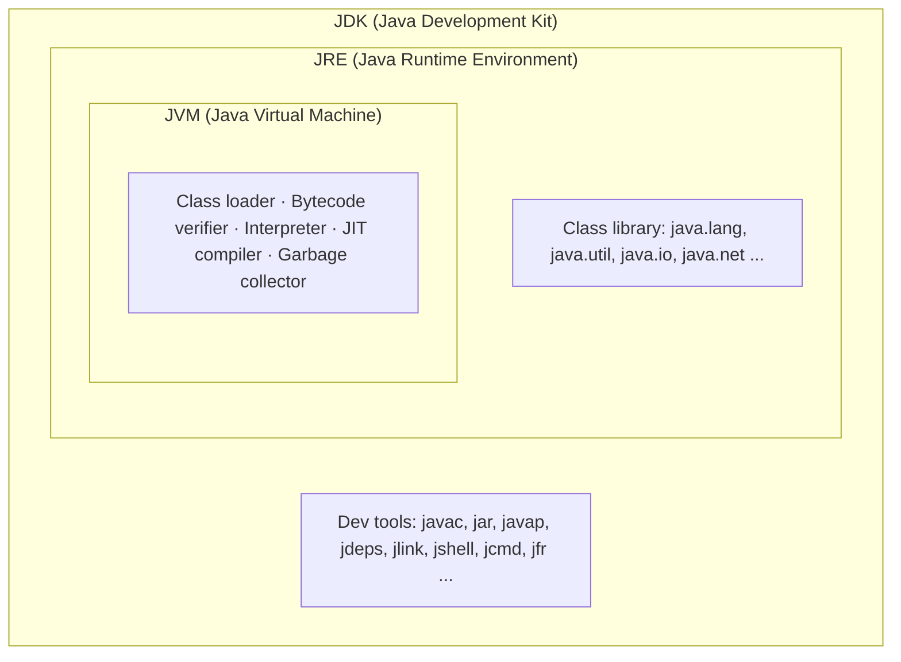
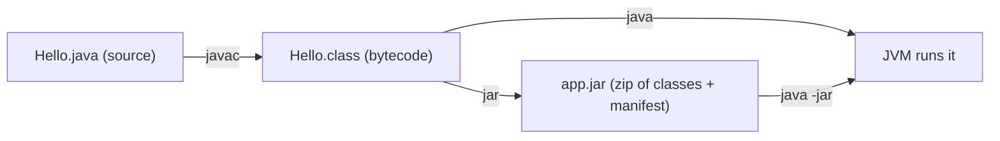

# 1. JDK vs JRE vs JVM



==JVM== = the engine that **runs bytecode** (`.class` files).
- Loads classes (class loaders), checks them (verifier), runs them (interpreter + JIT compiler that turns hot code into machine code), cleans memory (GC).
- The JVM is platform-specific (Linux / Windows / Mac build), bytecode is not. This gives "write once, run anywhere".
- HotSpot is the usual JVM. Others: OpenJ9, GraalVM.

==JRE== = JVM + the standard class library. Enough to **run** Java apps, not to build them.

==JDK== = JRE + **developer tools** (`javac`, `jar`, `javap`, `jlink` ...). You need this to **compile**.


Flow of a Java program:



---

# 2. javac / java / jar / javap

==javac== – compiler. `.java` → `.class`.

```bash
javac -d out src/com/demo/Main.java          # -d = output folder (keeps package dirs)
```

==java== – launcher. Starts a JVM and runs a class's `main` method.

```bash
java -cp out com.demo.Main                    # run a class from a classpath (use FULL class name)
java -jar app.jar                             # run jar; main class comes from MANIFEST
java Hello.java                               # Java 11+: run a single source file, no javac needed
java -Xms256m -Xmx1g -jar app.jar             # min / max heap size
```

==jar== – packs classes + resources into a zip file with `META-INF/MANIFEST.MF`.

```bash
jar --create --file app.jar --main-class com.demo.Main -C out .   # short: jar cfe app.jar com.demo.Main -C out .
jar tf app.jar                                # list contents (t = table, f = file)
jar xf app.jar                                # extract
```

Manifest example:
```
Manifest-Version: 1.0
Main-Class: com.demo.Main
Class-Path: lib/gson.jar          # optional: other jars, relative to this jar
```

==Thin jar vs fat jar==
- **Thin jar** = only your classes. Dependencies must be supplied on the classpath.
- **Fat / uber jar** = your classes **+ all dependency classes** in one jar. `java -jar app.jar` just works. Maven builds it with the **shade** (or assembly) plugin, Gradle with the **shadow** plugin. Spring Boot uses its own "nested jar" format.

==javap== – disassembler. Shows what is inside a `.class` file.

```bash
javap -cp out com.demo.Main          # public members (fields, method signatures)
javap -p -cp out com.demo.Main       # include private members
javap -c -cp out com.demo.Main       # bytecode instructions (see what the compiler generated)
javap -v -cp out com.demo.Main       # everything: constant pool, flags, "major version"
javap -v Main.class | grep major     # which Java version compiled this class
```

---

# 3. Classpath vs Modules (JPMS)

==Classpath== (old way, still the default)
- A flat list of folders and jars. The JVM searches it **top to bottom** for a class.
- Problems ("JAR hell"):
  - Two versions of the same library → the first one wins silently.
  - A missing jar is found only at **runtime** (`NoClassDefFoundError` / `ClassNotFoundException`).
  - Every `public` class is visible to everyone, even "internal" ones.

==Module path / JPMS== (Java 9+, Java Platform Module System)
- A **module** = a jar with a `module-info.class` that says its name, what it needs, and what it shows.

```java
// src/main/java/module-info.java
module com.demo.core {
    requires com.demo.api;                 // I need this module
    requires transitive java.sql;          // I need it, and my users get it too
    exports com.demo.core.service;         // only this package is public to others
    opens com.demo.core.model to com.fasterxml.jackson.databind;  // allow reflection (frameworks)
    uses com.demo.api.Plugin;              // ServiceLoader consumer
    provides com.demo.api.Plugin with com.demo.core.MyPlugin;     // ServiceLoader provider
}
```

- Benefits:
  - **Reliable configuration** – missing module = error at **startup**, not halfway through.
  - **Strong encapsulation** – packages not `exports`-ed are hidden, even `public` classes.
  - **No split packages** – the same package in two modules is an error.
  - `jlink` can build a small runtime with only needed modules.
- Run it:
```bash
javac -d out --module-source-path src $(find src -name "*.java")
java --module-path out -m com.demo.app/com.demo.app.Main
```
- Mixing old and new:
  - Jars on the **classpath** all go into one **unnamed module** (can read everything).
  - A plain jar on the **module path** becomes an **automatic module** (name from `Automatic-Module-Name` in manifest, or from the file name).
- The JDK itself is modular (`java.base`, `java.sql`, `java.net.http` ...). `java.base` is always there.

> [!note] Reality check
> most business apps (Spring Boot etc.) still run on the **classpath**. Know JPMS for interviews, libraries, and `jlink`. Fat jars + JPMS do not mix well.

| | Classpath | Module path (JPMS) |
|---|---|---|
| Unit | jar / folder | module (jar + `module-info`) |
| Missing dependency | found at runtime | found at startup |
| Visibility | all `public` is visible | only `exports` packages |
| Duplicate packages | first wins, silent | error |
| Flag | `-cp` / `--class-path` | `-p` / `--module-path`, `-m` |

---

# 4. source / target / release

Each class file has a **major version**: 52 = Java 8, 55 = 11, 61 = 17, 65 = 21, **69 = 25**. (Rule: Java N → 44 + N.)
An older JVM refuses newer bytecode: `UnsupportedClassVersionError ... class file version 65.0, this version only recognizes up to 61.0`.

- ==-source N== – which **language syntax** is allowed (e.g. no `record` with `-source 11`).
- ==-target N== – which **bytecode version** to produce.
- ==--release N== (Java 9+) – sets source + target **and** compiles against the **API of Java N**.

> [!tip] Rule: always use `--release`
> Why: with `javac -source 8 -target 8` on JDK 21, you can still call `String.isBlank()` (Java 11 API). It compiles, then crashes on Java 8 with `NoSuchMethodError`. `--release 8` catches that at compile time.

| Tool | How to set it |
|---|---|
| javac | `javac --release 21 ...` |
| Maven | `<maven.compiler.release>21</maven.compiler.release>` in `<properties>` |
| Gradle | `java { toolchain { languageVersion = JavaLanguageVersion.of(21) } }` or `tasks.withType<JavaCompile> { options.release = 21 }` |
| IntelliJ | Project Structure → Project → SDK + Language level; per module → Language level |

---

# 5. Maven & Gradle project layouts

Both use the same **standard folder layout** ("convention over configuration"):

```
my-project/
├── src/
│   ├── main/
│   │   ├── java/          # app code   (com/demo/Main.java)
│   │   └── resources/     # config files, copied into the jar (application.properties)
│   └── test/
│       ├── java/          # tests      (com/demo/MainTest.java)
│       └── resources/     # test-only files
├── pom.xml                # Maven  → output in target/
└── build.gradle.kts       # Gradle → output in build/
```

## Maven

## Gradle

