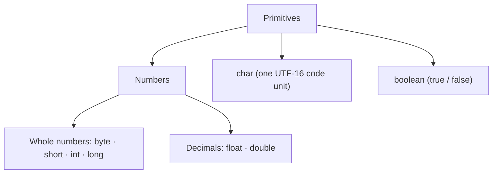
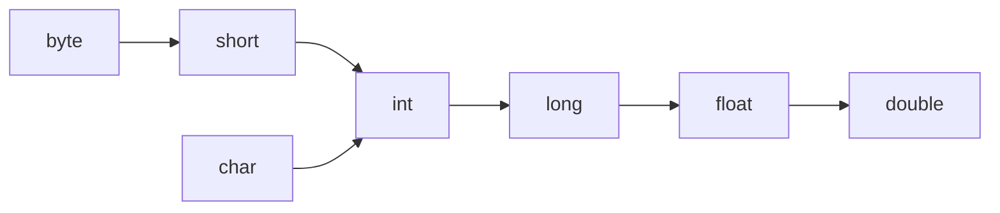
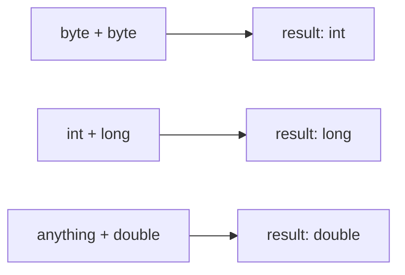
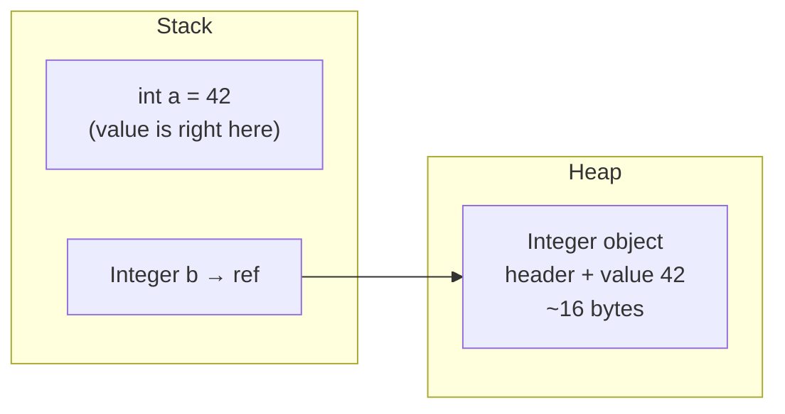
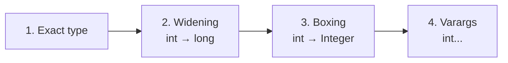

# 1. The 8 primitive types

A ==primitive== is a plain value, not an object. It has no methods and cannot be `null`, and it is stored directly in the variable.



| Type      | Size                  | Range                             | Default (fields) | Wrapper     |
| --------- | --------------------- | --------------------------------- | ---------------- | ----------- |
| `byte`    | 8 bit                 | -128 … 127                        | `0`              | `Byte`      |
| `short`   | 16 bit                | -32,768 … 32,767                  | `0`              | `Short`     |
| `int`     | 32 bit                | about ±2.1 billion (-2³¹ … 2³¹-1) | `0`              | `Integer`   |
| `long`    | 64 bit                | about ±9.2 × 10¹⁸ (-2⁶³ … 2⁶³-1)  | `0L`             | `Long`      |
| `float`   | 32 bit                | ~7 correct digits                 | `0.0f`           | `Float`     |
| `double`  | 64 bit                | ~15–16 correct digits             | `0.0`            | `Double`    |
| `char`    | 16 bit                | 0 … 65,535 (unsigned)             | CHAR_ZERO        | `Character` |
| `boolean` | not fixed by the spec | `true` / `false`                  | `false`          | `Boolean`   |

- Every whole-number type is **signed** except `char`.
- Defaults apply only to **fields** and **array slots**. A local variable has no default: using it before you assign it is a compile error.
- A plain number you type in code is an `int` (`5`) or a `double` (`5.0`).
- Primitives are **passed by value**: a method gets a copy, so the caller's variable never changes.

---

# 2. Literals

```java
int  million = 1_000_000;        // underscores are only for readability
long big     = 3_000_000_000L;   // L is needed: the number is too big for int
float f      = 1.5f;             // f is needed: 1.5 is a double
int hex      = 0xFF;             // 255
int bin      = 0b1010;           // 10
int oct      = 010;              // 8 (!) a leading 0 means octal
```

> [!warning] Traps
> - `int x = 2147483648;` is a **compile error**: the literal is too big for `int`. Write `2147483648L`.
> - `float f = 1.5;` is a compile error: a `double` does not fit into a `float` without a cast.
> - `010` is **8**, not 10.

---

# 3. Casting: widening and narrowing

==Widening== = small type → bigger type. It happens **automatically** and is safe.
==Narrowing== = big type → smaller type. It needs an **explicit cast** `(type)` and can lose data.



```java
int i = 100;
long l = i;          // widening, automatic
double d = l;        // widening, automatic
int back = (int) d;  // narrowing, cast required
```

What a narrowing cast does:

| Code          | Result       | Why                                           |
| ------------- | ------------ | --------------------------------------------- |
| `(int) 3.99`  | `3`          | cuts off the decimals (it does **not** round) |
| `(int) -3.99` | `-3`         | cuts toward zero                              |
| `(byte) 200`  | `-56`        | keeps only the low 8 bits                     |
| `(int) 1e20`  | `2147483647` | double → int is clamped to `MAX_VALUE`        |
| `(char) 65`   | `'A'`        |                                               |

---

# 4. Arithmetic rules

## Numeric promotion

Before any arithmetic, `byte`, `short` and `char` become **`int`**. Then both sides become the bigger type of the two.



```java
byte a = 10, b = 20;
byte c = a + b;          // ❌ compile error: a + b is an int
byte c = (byte) (a + b); // ✅
a += 1;                  // ✅ compound operators (+=, ++) cast silently
```

> [!warning] Compound operators hide casts
> `b += 1` really means `b = (byte)(b + 1)`. So `byte b = 127; b++;` silently gives `-128`.

## Division and remainder

```java
7 / 2        // 3     whole-number division drops the decimals
7 / 2.0      // 3.5   one double makes the result double
-7 / 2       // -3    rounds toward zero
-7 % 2       // -1    remainder takes the sign of the LEFT side
Math.floorMod(-7, 2) // 1   always ≥ 0 for a positive divisor (good for "wrap around")
1 / 0        // ArithmeticException
1.0 / 0      // Infinity (no exception for floating point)
```

> [!tip] Average without the bug
> `double avg = sum / count;` with two `int`s is **wrong**: the division happens in `int` first. Write `(double) sum / count`.

## The `i = i++` trap

```java
int i = 5;
i = i++;     // i is still 5
```
`i++` returns the **old** value (5), then adds 1. The assignment then writes the old 5 back.

## Overflow is silent

Whole-number types **wrap around** with no error:

```
 ... 2147483646 → 2147483647 (MAX) → -2147483648 (MIN) → ...
```

```java
Integer.MAX_VALUE + 1           // -2147483648
Math.abs(Integer.MIN_VALUE)     // -2147483648 (!) there is no positive version of MIN
int ms = 30 * 24 * 60 * 60 * 1000;   // overflows: the math is done in int
long ms = 30L * 24 * 60 * 60 * 1000; // ✅ one long at the start makes all of it long

Math.addExact(Integer.MAX_VALUE, 1)  // throws ArithmeticException instead of wrapping
Math.toIntExact(someLong)            // long → int, throws if it does not fit
```

> [!example] Classic overflow bugs
> - `mid = (low + high) / 2` overflows for big indexes. Use `low + (high - low) / 2`.
> - Comparator `(a, b) -> a - b` overflows for big values. Use `Integer.compare(a, b)`.

## Bit operators (quick)

| Operator   | Meaning                              | Example          |
| ---------- | ------------------------------------ | ---------------- |
| `<<`       | shift left (×2 per step)             | `1 << 4` = 16    |
| `>>`       | shift right, keeps the sign          | `-16 >> 2` = -4  |
| `>>>`      | shift right, fills with 0 (unsigned) | `-1 >>> 28` = 15 |
| `& \| ^ ~` | AND, OR, XOR, NOT on bits            | `6 & 3` = 2      |

---

# 5. Floating-point traps

`float` and `double` are stored in **binary** (IEEE 754). Most decimals such as 0.1 cannot be stored exactly, just like 1/3 cannot be written exactly in decimal.

```java
0.1 + 0.2              // 0.30000000000000004
0.1 + 0.2 == 0.3       // false
```

| Expression    | Result                            |
| ------------- | --------------------------------- |
| `1.0 / 0`     | `Infinity`                        |
| `0.0 / 0`     | `NaN` (Not a Number)              |
| `NaN == NaN`  | `false` (!) use `Double.isNaN(x)` |

How to compare doubles:
```java
Math.abs(a - b) < 1e-9          // "close enough" (epsilon) compare
Double.compare(a, b)            // safe ordering, handles NaN
```

> [!danger] Never use `float`/`double` for money
> Use `BigDecimal` (section 9) or store **cents in a `long`**.

Rounding:
```java
Math.round(2.5)    // 3
Math.round(-2.5)   // -2   (rounds half toward +infinity)
Math.floor(-2.5)   // -3.0
Math.ceil(-2.5)    // -2.0
```

---

# 6. `char` is a number

A `char` is an unsigned 16-bit number.

```java
char c = 'a';
c + 1              // 98 (an int, because of promotion)
(char) (c + 1)     // 'b'
'a' + 'b'          // 195 (an int!), not "ab"
"" + 'a' + 'b'     // "ab"
c - '0'            // turns the digit '7' into the number 7
```

String `+` goes left to right:
```java
1 + 2 + "3"   // "33"
"1" + 2 + 3   // "123"
```

---

# 7. Wrapper classes and autoboxing

Each primitive has a ==wrapper class==, an object that holds one value. You need wrappers because **generics only take objects**: `List<int>` is not allowed, `List<Integer>` is.

- ==Autoboxing== = Java turns `int` → `Integer` for you.
- ==Unboxing== = Java turns `Integer` → `int` for you.

```java
Integer boxed = 42;          // autoboxing → Integer.valueOf(42)
int raw = boxed;             // unboxing   → boxed.intValue()

List<Integer> list = new ArrayList<>();
list.add(5);                 // boxing
int first = list.get(0);     // unboxing
```



|                    | `int`   | `Integer`                                 |
| ------------------ | ------- | ----------------------------------------- |
| What it is         | a value | an object (reference)                     |
| Can be `null`      | no      | **yes**                                   |
| Memory             | 4 bytes | ~16 bytes + the reference                 |
| Usable in generics | no      | yes                                       |
| Compare with       | `==`    | `.equals()`                               |
| Changeable         | —       | **immutable**: `i++` creates a new object |

Useful wrapper methods:
```java
Integer.parseInt("42")      // int     (throws NumberFormatException on bad input)
Integer.valueOf("42")       // Integer (uses the cache, see below)
String.valueOf(42)          // "42"
Integer.MAX_VALUE, Integer.MIN_VALUE
Integer.compare(a, b), Integer.sum(a, b), Integer.max(a, b)   // handy as method refs
```

> [!note] `new Integer(5)` is deprecated
> Use `Integer.valueOf(5)` or just `Integer x = 5;`.

---

# 8. Boxing traps

## Trap 1: `==` on wrappers compares references

`Integer.valueOf` keeps a **cache** of objects for **-128 … 127**. Inside that range you get the same object every time. Outside it you get a new one.

```java
Integer a = 127, b = 127;
a == b          // true  (same cached object)

Integer x = 128, y = 128;
x == y          // false (two different objects!)
x.equals(y)     // true  ✅ always use equals for wrappers
```

- `Byte`, `Short`, `Long` and `Character` (0 … 127) cache too. `Float` and `Double` do not.

## Trap 2: unboxing `null` → NullPointerException

```java
Integer count = map.get("missing");   // null
int c = count;                        // 💥 NPE
if (count > 0) { }                    // 💥 NPE
Boolean flag = null;
if (flag) { }                         // 💥 NPE
```

## Trap 3: the ternary operator unboxes

If one side is `int` and the other is `Integer`, the result type is **`int`**:

```java
Integer v = cond ? map.get(k) : 0;    // 💥 NPE when map.get(k) is null
Integer v = map.getOrDefault(k, 0);   // ✅
```

## Trap 4: `equals` across wrapper types

```java
Long l = 1L;
l.equals(1)            // false: 1 is boxed to Integer, and Long ≠ Integer
l.equals(1L)           // true
```

## Trap 5: `List.remove(int)` vs `remove(Object)`

```java
List<Integer> list = new ArrayList<>(List.of(10, 20, 30));
list.remove(1);                    // removes INDEX 1 → [10, 30]
list.remove(Integer.valueOf(10));  // removes the VALUE 10 → [30]
```

## Trap 6: overloading picks widening before boxing

Java tries these in order and stops at the first match:



```java
void m(long x)    { System.out.println("long"); }
void m(Integer x) { System.out.println("Integer"); }

m(5);   // "long": widening wins over boxing
```

## Trap 7: hidden boxing costs performance

```java
Long sum = 0L;                       // ❌ wrapper
for (long i = 0; i < 1_000_000; i++) sum += i;   // a new Long object on every step

long sum = 0L;                       // ✅ primitive, much faster
IntStream.range(0, n).sum();         // ✅ primitive streams avoid boxing
```

## Trap 8: wrappers are immutable

```java
void addOne(Integer n) { n++; }   // makes a NEW Integer inside the method only
Integer count = 5;
addOne(count);                    // count is still 5
```

> [!tip] Rule of thumb
> Use primitives by default. Use wrappers only for generics/collections, or when "no value" (`null`) has a real meaning, such as a nullable DB column.

---

# 9. BigDecimal and BigInteger

## BigDecimal: exact decimals (money, rates, interest)

A `BigDecimal` = a whole number + a ==scale== (digits after the point). `12.50` = `1250` with scale `2`. It is **immutable**: every operation returns a new object.

```java
BigDecimal a = new BigDecimal("0.1");   // ✅ build from a String
BigDecimal b = BigDecimal.valueOf(0.2); // ✅ OK too
BigDecimal bad = new BigDecimal(0.1);   // ❌ 0.1000000000000000055511151231257827...

a.add(b)                                // 0.3 exactly
a.subtract(b), a.multiply(b)
price.setScale(2, RoundingMode.HALF_UP) // round to 2 decimals
```

Division needs a rounding rule if the result never ends:
```java
BigDecimal.ONE.divide(BigDecimal.valueOf(3));                          // 💥 ArithmeticException
BigDecimal.ONE.divide(BigDecimal.valueOf(3), 2, RoundingMode.HALF_UP); // 0.33
```

> [!warning] `equals` vs `compareTo`
> `equals` checks the value **and the scale**. `compareTo` checks only the value.
> ```java
> new BigDecimal("2.0").equals(new BigDecimal("2.00"))     // false
> new BigDecimal("2.0").compareTo(new BigDecimal("2.00"))  // 0 → equal ✅
> ```
> So in a `HashSet`/`HashMap`, `2.0` and `2.00` are two different keys.

Rounding modes you need:

| Mode        | 2.5 → | -2.5 → | Used for                                 |
| ----------- | ----- | ------ | ---------------------------------------- |
| `HALF_UP`   | 3     | -3     | normal school rounding                   |
| `HALF_EVEN` | 2     | -2     | "banker's rounding", common in finance   |
| `DOWN`      | 2     | -2     | just cut off (toward zero)               |

## BigInteger: whole numbers with no size limit

```java
BigInteger f = BigInteger.ONE;
for (int i = 2; i <= 50; i++) f = f.multiply(BigInteger.valueOf(i));   // 50! with no overflow
```

| Need                            | Use                            |
| ------------------------------- | ------------------------------ |
| Counting, indexes               | `int`                          |
| Big counts, timestamps, IDs     | `long`                         |
| Science, measurements           | `double`                       |
| Money / exact decimals          | `BigDecimal` (or `long` cents) |
| Bigger than `long`              | `BigInteger`                   |

