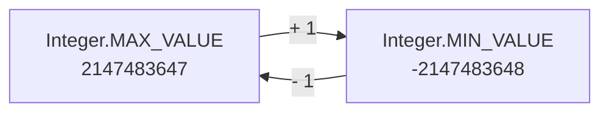
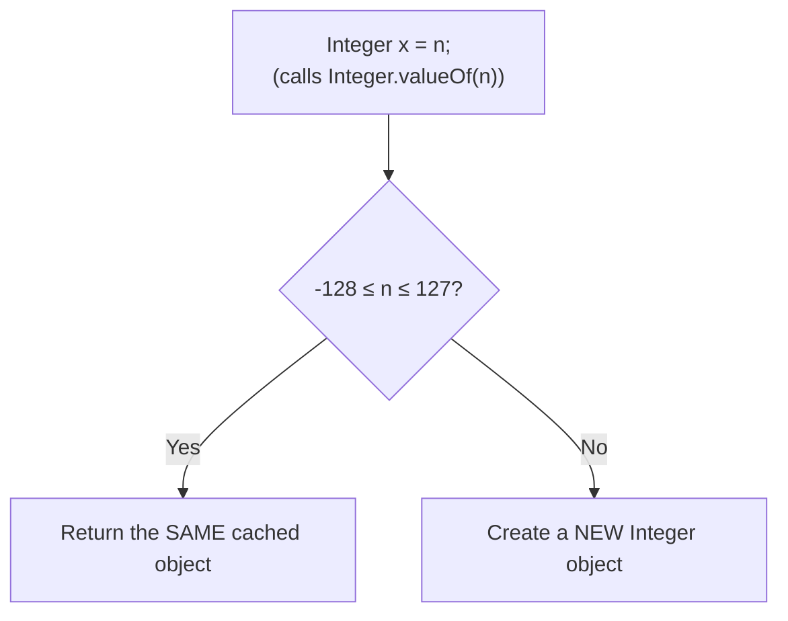
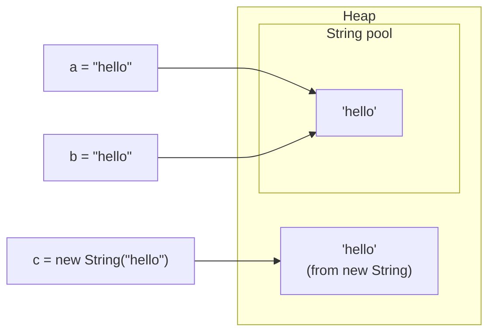
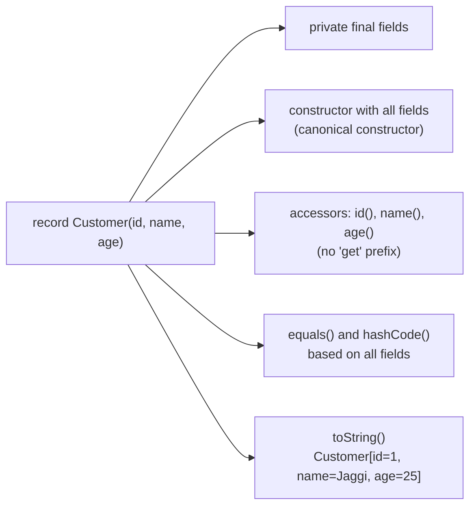
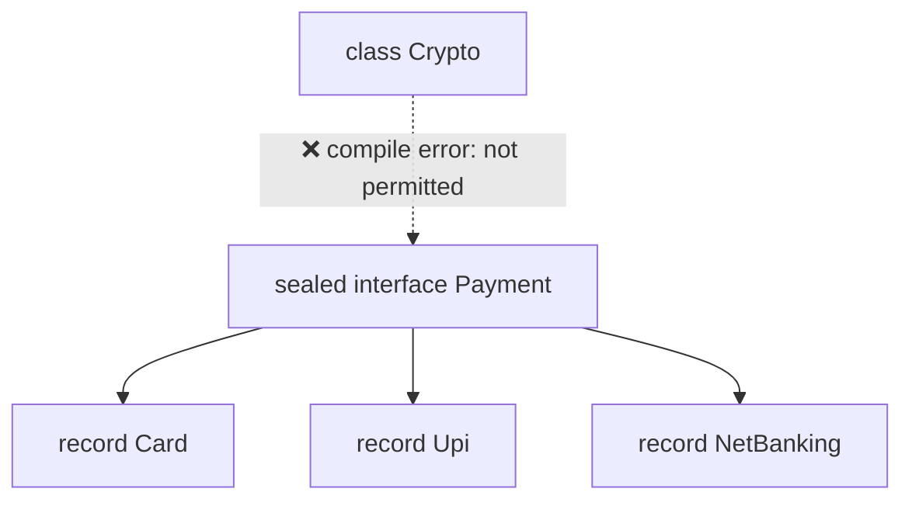

# Primitives, Overflow, Boxing & Money

## 1. Primitive types

A **primitive** is a raw value stored directly (not an object). Java has 8 of them.

| Type      | Size        | Range / precision                     | Default    |
| --------- | ----------- | ------------------------------------- | ---------- |
| `byte`    | 1 byte      | -128 .. 127                           | `0`        |
| `short`   | 2 bytes     | -32,768 .. 32,767                     | `0`        |
| `int`     | 4 bytes     | about ±2.1 billion (2³¹ − 1)          | `0`        |
| `long`    | 8 bytes     | about ±9.2 × 10¹⁸ (2⁶³ − 1)           | `0L`       |
| `float`   | 4 bytes     | about 7 decimal digits                | `0.0f`     |
| `double`  | 8 bytes     | about 15–16 decimal digits            | `0.0`      |
| `char`    | 2 bytes     | 0 .. 65,535 (unsigned, a UTF-16 unit) | `'\u0000'` |
| `boolean` | JVM decides | `true` / `false`                      | `false`    |

> [!warning] Defaults only apply to fields and array elements
> - **Fields** (class variables) and **array slots** get the defaults above.
> - **Local variables** (inside a method) get **no default**. Using one before assigning it is a **compile error**.
> ```java
> int[] arr = new int[3];   // [0, 0, 0]
> int x;
> System.out.println(x);    // ❌ compile error: x might not have been initialized
> ```

**Quick traps**
- `5 / 2` → `2` (int division drops the decimal part). Use `5 / 2.0` → `2.5`.
- `1 / 0` → `ArithmeticException`. But `1.0 / 0` → `Infinity` (no exception).
- `'a' + 1` → `98` (char is promoted to int). `(char) ('a' + 1)` → `b`.
- `byte b = 10; b = b + 5;` ❌ does not compile (`b + 5` is an `int`).
  `b += 5;` ✅ compiles, because **compound operators** (`+=`, `-=` …) add a hidden cast.

---

## 2. Integer overflow

**Overflow** = the result is too big for the type. Java does **not** throw an error. The value silently **wraps around** to the other end.




```java
int max = Integer.MAX_VALUE;
System.out.println(max + 1);              // -2147483648
```

> [!warning] The classic trap: overflow happens *before* widening
> ```java
> long x = 1_000_000 * 1_000_000;    // -727379968  ❌
> long y = 1_000_000L * 1_000_000;   // 1000000000000 ✅
> ```
> The right side is computed as `int * int` **first**, overflows, and only then is stored in a `long`. Making one operand `long` (`L` suffix) fixes it.

**Where interviewers check this**
- **Binary search mid**: `(lo + hi) / 2` can overflow. Use `lo + (hi - lo) / 2`.
- **Sum of a big array**: keep the sum in a `long`.
- **`Math.abs(Integer.MIN_VALUE)`** → still `-2147483648`, because `+2147483648` does not fit in an `int`.

> [!tip] Want an error instead of silent wrap?
> Use `Math.addExact(a, b)`, `Math.multiplyExact(a, b)`, `Math.toIntExact(longVal)`. They throw `ArithmeticException` on overflow.

**Casting down cuts off the high bits**
```java
byte b = (byte) 200;   // -56   (200 - 256)
int i = (int) 3.99;    // 3     (cuts the decimals, does not round)
```

---

## 3. Wrapper classes, autoboxing & the Integer cache

- A **wrapper class** is the object version of a primitive: `int` → `Integer`, `long` → `Long`, `double` → `Double`, etc.
- Collections like `List` and `Map` can only hold objects, so they need wrappers.
- **Autoboxing** = Java turns a primitive into a wrapper for you: `Integer a = 5;` really runs `Integer.valueOf(5)`.
- **Unboxing** = the reverse: `int b = a;` really runs `a.intValue()`.

### The Integer cache

`Integer.valueOf(n)` keeps a ready-made **cache** of `Integer` objects for **-128 to 127**. Inside that range you always get the **same object**. Outside it, you get a **new object** each time.



### The `==` trap

On objects, `==` checks **"same object in memory?"**, not **"same value?"**.

```java
Integer a = 127, b = 127;
System.out.println(a == b);       // true   (both from the cache)

Integer c = 128, d = 128;
System.out.println(c == d);       // false  (two different objects)
System.out.println(c.equals(d));  // true   (same value)
```

> [!warning] Rule
> ==Always compare wrapper objects with `.equals()`== (or unbox to `int` first). `==` only "works" by luck inside -128..127.
> `Short`, `Byte`, `Long`, and `Character` (0..127) have the same kind of cache. `Double` and `Float` have **no** cache.

**When `==` does unbox:** if **one side is a primitive**, the wrapper is unboxed and values are compared.
```java
Integer c = 128;
System.out.println(c == 128);     // true (c is unboxed to int)
```

---

## 4. Autoboxing cost and traps

### Cost: hidden objects

```java
Long sum = 0L;                        // ❌ wrapper
for (long i = 0; i < 1_000_000; i++) {
    sum += i;     // unbox, add, box a NEW Long — 1 million objects
}

long sum2 = 0L;                       // ✅ primitive, no objects
```

- Every box can create an object → more memory and more **garbage collection** (GC = the JVM cleaning up unused objects).
- ==Use primitives in loops and math. Use wrappers only when you need an object== (collections, generics, "no value" = `null`).

### Trap: unboxing `null` → NullPointerException

```java
Integer n = null;
int m = n;            // 💥 NullPointerException (calls n.intValue())

Map<String, Integer> map = new HashMap<>();
int count = map.get("x");   // 💥 NPE: get() returned null
int safe  = map.getOrDefault("x", 0);   // ✅
```

### Trap: `equals` across types

```java
Long l = 127L;
System.out.println(l.equals(127));   // false  (127 is boxed to Integer, not Long)
System.out.println(l.equals(127L));  // true
```

### Trap: `List.remove(int)` vs `remove(Object)`

```java
List<Integer> list = new ArrayList<>(List.of(10, 20, 30));
list.remove(1);                    // removes by INDEX → [10, 30]
list.remove(Integer.valueOf(10));  // removes by VALUE → [30]
```

---

## 5. float/double precision: why `0.1 + 0.2 != 0.3`

```java
System.out.println(0.1 + 0.2);          // 0.30000000000000004
System.out.println(0.1 + 0.2 == 0.3);   // false
```

**Why?**
- `double` stores numbers in **binary** (base 2), using the **IEEE 754** standard.
- Some decimals cannot be written exactly in binary, just like `1/3 = 0.3333…` never ends in decimal.
- `0.1` in binary is `0.0001100110011…` (repeats forever), so it gets **rounded** to the nearest value that fits.
- The tiny rounding errors of `0.1` and `0.2` add up, and the sum lands just above `0.3`.

| Decimal | Exact in binary? |
|---|---|
| `0.5` = 1/2 | ✅ yes |
| `0.25` = 1/4 | ✅ yes |
| `0.1` = 1/10 | ❌ no, repeats forever |

> [!tip] Comparing doubles
> Never use `==`. Check if they are "close enough":
> ```java
> Math.abs(a - b) < 1e-9
> ```

---

## 6. Money: `BigDecimal` or `long` cents

> [!warning] Never store money in `float` or `double`
> Small errors add up over many transactions. `0.1 + 0.2` rupees ≠ `0.3` rupees is a real bug in banks.

### Option A: `long` in the smallest unit (cents / paise)

```java
long priceInPaise = 1999;   // ₹19.99
long total = priceInPaise * 3;   // 5997 → ₹59.97, exact
```
- ✅ Fast, exact, simple.
- ❌ You must handle division/rounding yourself (e.g. split ₹10 three ways), and remember the unit everywhere.

### Option B: `BigDecimal`

**BigDecimal** = a decimal number stored exactly in base 10, with a **scale** (number of digits after the point).

```java
BigDecimal a = new BigDecimal("0.1");
BigDecimal b = new BigDecimal("0.2");
System.out.println(a.add(b));   // 0.3 ✅

BigDecimal emi = new BigDecimal("10")
        .divide(new BigDecimal("3"), 2, RoundingMode.HALF_EVEN);  // 3.33
```

> [!warning] BigDecimal traps
> | Trap | Wrong | Right |
> |---|---|---|
> | Building from a double | `new BigDecimal(0.1)` → `0.1000000000000000055511151231257827021181583404541015625` | `new BigDecimal("0.1")` or `BigDecimal.valueOf(0.1)` |
> | Comparing | `new BigDecimal("2.0").equals(new BigDecimal("2.00"))` → `false` (scale differs) | `a.compareTo(b) == 0` → `true` |
> | Endless division | `ONE.divide(THREE)` → `ArithmeticException` | pass scale + `RoundingMode` |
> | Immutable | `a.add(b);` (result thrown away) | `a = a.add(b);` |

- `RoundingMode.HALF_EVEN` = "**banker's rounding**": round .5 to the nearest even digit, so rounding errors cancel out over many values.

| | `double` | `long` cents | `BigDecimal` |
|---|---|---|---|
| Exact for money | ❌ | ✅ | ✅ |
| Speed | Fast | Fastest | Slow (object, more work) |
| Rounding control | ❌ | Manual | ✅ `RoundingMode` |
| Typical use | Science, graphics | High-volume payments, ledgers | Interest, tax, EMI calculations |


---

# Strings

## 1. What a String is

- A `String` is an **object** that holds a sequence of characters.
- Inside, it keeps a **private final array** of the characters (a `byte[]` since Java 9, which saves memory for plain English text).
- `String` is **immutable**: once it's created, its content **never changes**.

```java
String s = "hello";
s.toUpperCase();          // ❌ creates "HELLO" and throws it away
System.out.println(s);    // hello

s = s.toUpperCase();      // ✅ s now points to a NEW object "HELLO"
```

> [!note] "Changing" a String really means making a new one
> `concat`, `replace`, `toUpperCase`, `substring`, `trim` … all **return a new String**. The original stays the same.


## 2. Why String is immutable

| Reason | What it means |
|---|---|
| **String pool** | Many variables can share **one** `"hello"` object. That's only safe because nobody can change it. |
| **Security** | Strings hold file paths, URLs, DB usernames, class names. If they could change **after** a security check, an attacker could swap the value. |
| **Hashing** | `hashCode()` is computed once and **cached**. A String key in a `HashMap` can never change, so it never gets "lost" in the wrong bucket. |
| **Thread safety** | Immutable objects can be shared between threads with **no locks**. |

**How Java makes it immutable**
- The class is `final` → nobody can subclass it and add a setter.
- The character array is `private final` and never exposed.
- No method modifies the array; every "change" returns a new String.

---

## 3. String pool, `==` vs `equals`, and `intern()`

- **String pool** = a special area in the heap that stores **one copy** of each string **literal** (text in double quotes in your code).
- **Literal** `"hi"` → taken from the pool (reused).
- **`new String("hi")`** → always creates a **new object** in the normal heap.



- `==` → are these the **same object**? (compares references)
- `.equals()` → do they have the **same characters**? (compares content)
- `intern()` → returns the **pool copy** of the string (adds it to the pool if missing).

### What does this print?

```java
String a = "hello";
String b = "hello";
String c = new String("hello");
String d = c.intern();
String e = "hel" + "lo";      // both literals → joined at COMPILE time
String part = "hel";
String f = part + "lo";       // uses a variable → joined at RUN time

a == b          // true   same pool object
a == c          // false  c is a separate heap object
a.equals(c)     // true   same characters
a == d          // true   intern() returns the pool copy
a == e          // true   compiler turned it into the literal "hello"
a == f          // false  built at run time → new object
a == f.intern() // true
```

> [!tip] `final` changes the answer
> `final String part = "hel";` makes `part` a **compile-time constant**, so `part + "lo" == "hello"` becomes `true`.

> [!question] "How many objects does `new String("hello")` create?"
> **Up to 2**: one `"hello"` in the pool (only if it isn't there already) + one new object on the heap.

> [!warning] Rule
> ==Always compare Strings with `.equals()`==. Use `"literal".equals(s)` to be safe when `s` might be `null`.

---

## 4. String vs StringBuilder vs StringBuffer

| | `String` | `StringBuilder` | `StringBuffer` |
|---|---|---|---|
| Can change? | ❌ immutable | ✅ mutable | ✅ mutable |
| Thread-safe? | ✅ (immutable) | ❌ | ✅ (`synchronized` methods) |
| Speed | New object on every change | **Fastest** | Slower (locking) |
| Use for | Fixed text, map keys | Building text in a loop | Legacy code only |

- **Mutable** = can be changed in place.
- **`synchronized`** = only one thread can run the method at a time (safe, but slower).
- `StringBuilder` keeps an internal array (starts at **16** chars) and **grows** it when full, so most appends just write into free space.

```java
StringBuilder sb = new StringBuilder();
sb.append("ab").append(1).append('c');   // "ab1c"
sb.insert(0, "X");                       // "Xab1c"
sb.reverse();                            // "c1baX"
sb.setCharAt(0, 'Z');                    // "Z1baX"
sb.deleteCharAt(sb.length() - 1);        // "Z1ba"
String result = sb.toString();
```

> [!warning] StringBuilder does NOT override `equals`
> ```java
> new StringBuilder("a").equals(new StringBuilder("a"));   // false (compares references)
> sb1.toString().equals(sb2.toString());                    // true
> ```

---

## 5. Concatenation in a loop: O(n²)

```java
String s = "";
for (int i = 0; i < n; i++) {
    s += "x";          // ❌ copies the whole string every time
}
```

Each `+=` creates a **new** String and **copies all old characters** into it.

| Iteration | Chars copied |
|---|---|
| 1 | 1 |
| 2 | 2 |
| 3 | 3 |
| … | … |
| n | n |
| **Total** | 1 + 2 + … + n = n(n+1)/2 → ==**O(n²)**== |

```java
StringBuilder sb = new StringBuilder();
for (int i = 0; i < n; i++) {
    sb.append("x");    // ✅ writes into the existing array
}
String s = sb.toString();   // total O(n)
```

- `append` is **amortized O(1)**: the array occasionally doubles, but averaged over all appends the cost per append is constant.
- A **single line** like `String s = a + b + c;` is fine. The compiler already optimizes it. The problem is only `+=` **inside a loop**.

---

## 6. Common methods

| Method | Result | Notes |
|---|---|---|
| `length()` | number of chars | arrays use `.length`, lists use `.size()` |
| `charAt(i)` | char at index `i` | `StringIndexOutOfBoundsException` if out of range |
| `substring(b, e)` | chars from `b` to `e - 1` | **end is exclusive**; O(n), it copies |
| `indexOf(x)` / `lastIndexOf(x)` | position, or `-1` | |
| `contains`, `startsWith`, `endsWith` | `boolean` | |
| `equals`, `equalsIgnoreCase` | `boolean` | |
| `compareTo(other)` | `<0`, `0`, `>0` | dictionary order |
| `toCharArray()` | new `char[]` | copy, O(n) |
| `String.valueOf(x)` / `new String(char[])` | String | convert back from `char[]` / numbers |
| `split(regex)` | `String[]` | argument is a **regex** |
| `trim()` / `strip()` | removes outer spaces | `strip()` also handles Unicode spaces |
| `isEmpty()` / `isBlank()` | `""` / only spaces | |
| `replace(a, b)` / `replaceAll(regex, b)` | new String | `replace` replaces **all** matches too, no regex |
| `String.join(",", list)` | `"a,b,c"` | |
| `repeat(n)` | `"ab".repeat(3)` → `"ababab"` | |

---

## 7. Unicode: char vs code point

- **Unicode** = a giant numbered list of every character in every language (plus emoji).
- **Code point** = a character's number in that list. `'A'` = 65, `😀` = 128512.
- Java's `char` is **16 bits**, so it can only hold values up to 65,535.
- Characters above that (most **emoji**, rare scripts) take **2 chars**, called a **surrogate pair**. This encoding is called **UTF-16**.

```java
String s = "a😀";
s.length();                         // 3   (counts chars, not characters)
s.codePointCount(0, s.length());    // 2   (real characters)
s.charAt(1);                        // half of the emoji — a broken char
```

```
"a😀"  →  chars:       [ 'a' ][ \uD83D ][ \uDE00 ]
          code points: [ 'a' ][      😀          ]
```

> [!tip] What matters in interviews
> - For LeetCode-style problems (letters a–z), `char` is all you need.
> - `c - 'a'` turns `'a'..'z'` into `0..25` → perfect array index.
> - `Character.isLetterOrDigit(c)`, `Character.isDigit(c)`, `Character.toLowerCase(c)` are your helpers.
> - If asked about emoji: `length()` counts chars, not characters. Use `codePoints()` to loop over real characters.


---

# Modern Java Syntax (17/21)

## 1. Which feature came in which version


| Feature | Final in | Usable on Java 17? |
|---|---|---|
| `var` | 10 | ✅ |
| Switch expressions (`->`, `yield`) | 14 | ✅ |
| Text blocks (`"""`) | 15 | ✅ |
| Records | 16 | ✅ |
| Pattern matching for `instanceof` | 16 | ✅ |
| Sealed classes / interfaces | 17 | ✅ |
| Pattern matching for `switch` | 21 | ❌ preview only |
| Record patterns (`case Point(int x, int y)`) | 21 | ❌ preview only |

> [!note] Preview feature
> A **preview** feature is in the language but not final. It needs the `--enable-preview` flag and may change. Production code doesn't use them.

---

## 2. `var`: local type inference

`var` lets the compiler **work out the type** of a local variable from the right-hand side.

```java
var names = new ArrayList<String>();   // type is ArrayList<String>
var count = 10;                        // int
for (var entry : map.entrySet()) { }   // Map.Entry<K, V>
```

- It is still **statically typed**: the type is fixed at compile time. `names = 5;` → compile error.
- Only for **local variables** that have an **initializer**.

| ❌ Not allowed | Why |
|---|---|
| `var x;` | no value to infer from |
| `var x = null;` | `null` has no type |
| Fields, method parameters, return types | `var` is local only |
| `var f = () -> 1;` | a lambda needs a target type |
| `var arr = {1, 2};` | array initializer needs the type |

### When NOT to use `var`

> [!warning] Use `var` only when the type is obvious from the right side
> - **Hidden type**: `var result = service.process(req);` → reader can't tell what `result` is. Write the type.
> - **Diamond trap**: `var list = new ArrayList<>();` → becomes `ArrayList<Object>`.
> - **Numbers**: `var total = 0;` is an `int`, even if you meant `long`. Overflow risk.
> - **You want the interface type**: `var list = new ArrayList<String>();` gives `ArrayList`, not `List`.
>
> ✅ Good use: long generic types where the right side already says it all: `var map = new HashMap<String, List<Order>>();`

---

## 3. Text blocks

A **text block** is a multi-line String literal between `"""`.

```java
// Before
String json = "{\n" +
              "  \"name\": \"Jaggi\",\n" +
              "  \"age\": 25\n" +
              "}";

// Java 15+
String json = """
        {
          "name": "Jaggi",
          "age": 25
        }
        """;
```

- The opening `"""` must be followed by a **new line**.
- Common leading spaces are **removed** automatically (based on the least-indented line, including the closing `"""`).
- No need to escape `"` inside.
- Use it for **JSON, SQL, HTML** in code and tests.
- Fill in values with `.formatted(...)`, e.g. `json.formatted(name, age)` when the block contains `%s` / `%d`.

---

## 4. Switch expressions

A **switch expression** returns a value. The arrow form `->` has **no fall-through** (no `break` needed).

```java
// Old switch statement
String label;
switch (status) {
    case PENDING: label = "Waiting"; break;
    case SUCCESS: label = "Done";    break;     // forget a break → bug
    default:      label = "Failed";
}

// Switch expression (Java 14+)
String label = switch (status) {
    case PENDING        -> "Waiting";
    case SUCCESS        -> "Done";
    case FAILED, REVERSED -> "Failed";          // several labels on one case
};
```

- Use **`yield`** to return a value from a block:
  ```java
  int fee = switch (type) {
      case CARD -> 20;
      case UPI  -> {
          log.info("free");
          yield 0;
      }
      default -> 10;
  };
  ```
- **Exhaustive**: a switch expression must cover **every** case. For an enum, listing all constants is enough (no `default`). If a new constant is added later, the code **stops compiling** until you handle it. That's a feature.

---

## 5. Records

A **record** is a short way to write an **immutable data class**.

```java
public record Customer(String id, String name, int age) { }
```

The compiler generates all of this for you:



- The class is **`final`** → cannot be extended. It also cannot extend another class (it already extends `Record`).
- It **can** implement interfaces, and have static fields, static methods and extra instance methods.
- It **cannot** declare extra instance fields.

### Validation: the compact constructor

```java
public record Money(BigDecimal amount, String currency) {
    public Money {                                   // no parameter list
        if (amount.signum() < 0) throw new IllegalArgumentException("negative");
        Objects.requireNonNull(currency);
    }
}
```

> [!warning] Records are only *shallowly* immutable
> ```java
> record Order(List<String> items) { }
> var list = new ArrayList<>(List.of("a"));
> var order = new Order(list);
> list.add("b");             // order.items() now has "b" too 😬
> ```
> Fix: make a copy in the compact constructor: `items = List.copyOf(items);`

**Good for:** DTOs (request/response objects), value objects (`Money`, `Point`), map keys, returning several values from a method.
**Not for:** JPA entities (they need a no-arg constructor, setters and subclass proxies).

---

## 6. Records vs Lombok

**Lombok** = a library that generates getters, setters, constructors etc. from annotations (`@Data`, `@Value`, `@Builder`) at compile time.

| | `record` | Lombok (`@Data` / `@Value`) |
|---|---|---|
| What is it | Built into the language | Third-party library (annotation processor) |
| Mutable? | ❌ always immutable | `@Data` mutable, `@Value` immutable |
| Accessor names | `name()` | `getName()` |
| Builder | ❌ (write it yourself) | ✅ `@Builder` |
| Inheritance | ❌ can't extend a class | ✅ |
| JPA entities | ❌ | ✅ (`@Getter` / `@Setter`) |
| Extra dependency / IDE plugin | ❌ none | ✅ needed |

> [!tip] Interview answer
> "For **immutable data carriers** like DTOs and value objects, I use **records**: no dependency, it's standard Java, and `equals`/`hashCode` are always correct. I keep **Lombok** for **JPA entities**, mutable classes, classes that need **inheritance**, or when a **builder** for many optional fields really helps."

---

## 7. Sealed classes and interfaces

A **sealed** type lists **exactly** which classes may extend or implement it.

```java
public sealed interface Payment permits Card, Upi, NetBanking { }
```

Each permitted subtype must say how it continues the hierarchy:

| Modifier | Meaning |
|---|---|
| `final` | nobody can extend it further (records are already final) |
| `sealed` | it also lists its own allowed subtypes |
| `non-sealed` | open again: anyone can extend it |



**Why use it**
- Models a **closed set** of options ("a payment is one of these 3, nothing else").
- The compiler knows **all** subtypes → a `switch` over them can be **exhaustive** with no `default`.
- Add a new subtype → every switch that forgot it **fails to compile**. No silent bugs.

> [!note] Sealed vs enum
> **Enum** = fixed set of **single instances** (`PENDING`, `SUCCESS`). **Sealed** = fixed set of **types**, each carrying **its own data** (`Card` has a card number, `Upi` has a UPI ID).

---

## 8. Pattern matching

### `instanceof` (Java 16+, usable on 17)

Check the type **and** get a typed variable in one step. No manual cast.

```java
// Before
if (obj instanceof String) {
    String s = (String) obj;
    System.out.println(s.length());
}

// Now
if (obj instanceof String s && s.length() > 3) {
    System.out.println(s.length());
}
```

- `s` is only in scope where the check is **definitely true**.
- `obj instanceof String s || s.isEmpty()` → ❌ compile error (`s` may not exist there).

### `switch` patterns (Java 21)

```java
String describe(Object o) {
    return switch (o) {
        case null                       -> "null";           // otherwise switch throws NPE
        case Integer i when i > 100     -> "big number";     // 'when' = extra condition (guard)
        case Integer i                  -> "number " + i;
        case String s                   -> "text " + s;
        default                         -> "other";
    };
}
```

- **Order matters**: put specific cases (with `when`) **before** general ones. A case that can never match is a compile error.
- **Record patterns** take a record apart in place:
  ```java
  record Point(int x, int y) { }
  if (obj instanceof Point(int x, int y)) { return x + y; }
  ```

---

## 9. Optional: using it well

**`Optional<T>`** = a box that holds **one value or nothing**. It makes "might be missing" visible in the method signature.

```java
Optional<Customer> findById(String id);

String name = findById(id)
        .map(Customer::name)              // transform if present
        .filter(n -> !n.isBlank())
        .orElse("Unknown");               // default if empty

Customer c = findById(id)
        .orElseThrow(() -> new NotFoundException(id));   // fail clearly
```

| Method | Use it for |
|---|---|
| `map`, `flatMap`, `filter` | transform without null checks |
| `orElse(x)` | default value that's already computed |
| `orElseGet(() -> x)` | default that's **expensive** to compute (lazy) |
| `orElseThrow()` | "must exist" (Java 10+, better name than `get()`) |
| `ifPresentOrElse(a, b)` | run code for both cases (Java 9+) |
| `or(() -> otherOptional)` | fall back to another source (Java 9+) |
| `isEmpty()` | opposite of `isPresent()` (Java 11+) |
| `stream()` | turn into a 0- or 1-element stream (Java 9+) |

> [!warning] Optional traps
> - `orElse(loadFromDb())` **always** calls `loadFromDb()`, even when a value exists. Use `orElseGet(() -> loadFromDb())`.
> - `Optional.of(null)` → NPE. Use `Optional.ofNullable(x)`.
> - `opt.get()` without checking → `NoSuchElementException`. Prefer `orElseThrow`.
> - `if (opt.isPresent()) { opt.get() … }` is just a null check in disguise. Use `map` / `ifPresent`.

> [!tip] Where to use Optional
> ✅ **Return types** of methods that may find nothing.
> ❌ **Fields**, **method parameters**, **collections** (return an empty list instead of `Optional<List>`), and anything serialized.

---

## 10. Java 8 → modern Java: a full rewrite

A payment model with a fee calculator, written in Java 8 style and then with records, a sealed hierarchy and switch expressions.

### Before (Java 8, ~45 lines)

```java
public abstract class Payment {
    private final BigDecimal amount;
    protected Payment(BigDecimal amount) { this.amount = amount; }
    public BigDecimal getAmount() { return amount; }
}

public final class CardPayment extends Payment {
    private final String cardNumber;
    public CardPayment(BigDecimal amount, String cardNumber) {
        super(amount);
        this.cardNumber = cardNumber;
    }
    public String getCardNumber() { return cardNumber; }
    @Override public boolean equals(Object o) { /* 6 lines */ }
    @Override public int hashCode() { return Objects.hash(getAmount(), cardNumber); }
    @Override public String toString() { return "CardPayment[" + getAmount() + "]"; }
}

public final class UpiPayment extends Payment {
    private final String upiId;
    // same constructor, getter, equals, hashCode, toString again…
}

public final class NetBankingPayment extends Payment {
    private final String bank;
    // …and again
}

public class FeeCalculator {
    public BigDecimal fee(Payment p) {
        if (p instanceof CardPayment) {
            CardPayment c = (CardPayment) p;
            return c.getAmount().multiply(new BigDecimal("0.02"));
        } else if (p instanceof UpiPayment) {
            return BigDecimal.ZERO;
        } else if (p instanceof NetBankingPayment) {
            return new BigDecimal("10");
        }
        throw new IllegalArgumentException("Unknown payment: " + p);  // found only at run time
    }

    public String label(Status status) {
        String label;
        switch (status) {
            case PENDING: label = "Waiting"; break;
            case SUCCESS: label = "Done"; break;
            default: label = "Failed";
        }
        return label;
    }
}
```

### After (Java 21, ~20 lines)

```java
public sealed interface Payment permits Card, Upi, NetBanking {
    BigDecimal amount();                         // each record's accessor implements this
}

public record Card(BigDecimal amount, String cardNumber) implements Payment { }
public record Upi(BigDecimal amount, String upiId) implements Payment { }
public record NetBanking(BigDecimal amount, String bank) implements Payment { }

public class FeeCalculator {
    public BigDecimal fee(Payment p) {
        return switch (p) {
            case Card c       -> c.amount().multiply(new BigDecimal("0.02"));
            case Upi u        -> BigDecimal.ZERO;
            case NetBanking n -> new BigDecimal("10");
        };                                       // no default: the compiler knows all 3
    }

    public String label(Status status) {
        return switch (status) {
            case PENDING -> "Waiting";
            case SUCCESS -> "Done";
            case FAILED  -> "Failed";
        };
    }
}
```

| What changed | Gain |
|---|---|
| 3 classes → 3 one-line **records** | no hand-written constructor, getters, `equals`, `hashCode`, `toString` |
| `abstract class` → **sealed interface** | closed set of payment types |
| `instanceof` chain → **pattern switch** | no casts, no `throw` fallback |
| No `default` | add `Crypto` → `fee()` **fails to compile** instead of failing in production |
| Switch statement → **switch expression** | no `break`, no fall-through bug, returns a value |

> [!warning] On Java 17
> Records, sealed types and the `label()` switch all work. The **pattern `switch` in `fee()` needs Java 21**. On 17, use an `instanceof` pattern chain instead:
> ```java
> if (p instanceof Card c) return c.amount().multiply(new BigDecimal("0.02"));
> if (p instanceof Upi)    return BigDecimal.ZERO;
> if (p instanceof NetBanking) return new BigDecimal("10");
> throw new IllegalStateException();   // no exhaustiveness check on 17
> ```
