# The LLD method & UML essentials

### LLD interview flow 

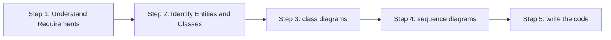


### The 5 step method 

to solve any LLD problem 

1. understand the problem (try to grasp almost all functionality what it will do what not)
2. from the requirement (extract nouns and verbs) eg. 
![[Pasted image 20261021142138.png]]
3. **Draw ==class diagram ==**
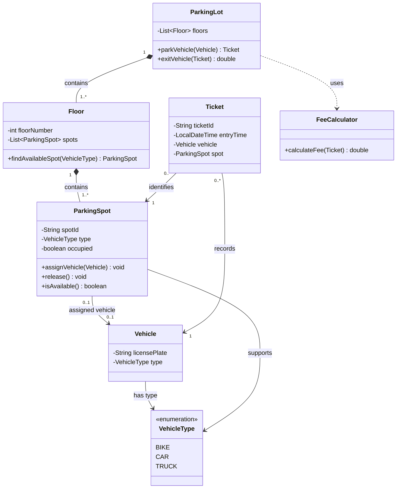

4. **Draw ==sequence diagram== (class diagram means what exist and what not) sequence diagram means what happens and in what order** 
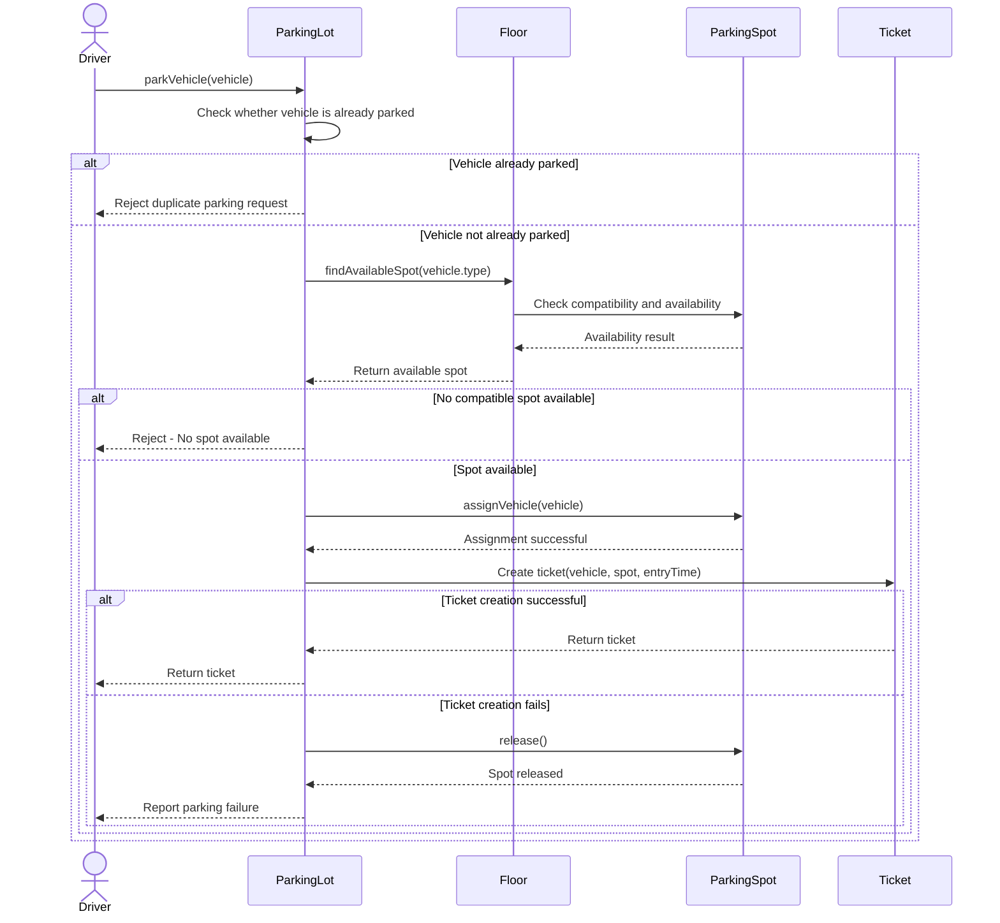

5. write the ==code ==


### UML Class Diagrams Notations 


1. **==UML Class==**

The three sections mean: name (top), attributes (middle), methods (lower)
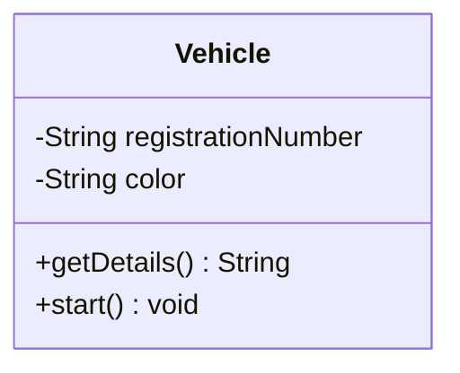

| Symbol | Meaning   |
| ------ | --------- |
| `+`    | Public    |
| `-`    | Private   |
| `#`    | Protected |
| `~`    | Package   |

---

2. **==Association ==**


if 2 classes objects -> know about each other, maintain relationship with each other, interact with each other eg. 
- A `Vehicle` parks in a `ParkingSpot`.
- The spot knows which vehicle occupies it.
- The vehicle is associated with that spot while parked.

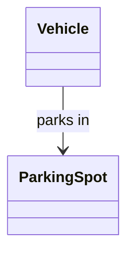


A customer can place multiple orders, while each order belongs to one customer in this example.

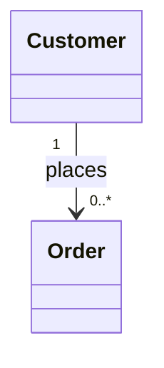

---

3. ==**Aggregation** ==

a whole contains or groups other objects, but those objects can exist independently of that whole. (a university has professors, but professors can exist independently.)

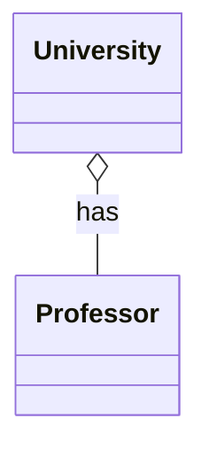


---

4. ==**Composition**==

one object strongly owns its parts, and the parts' lifetimes depend on that owner. (If the parking lot is deleted, its floors are deleted as part of that same lifecycle.)

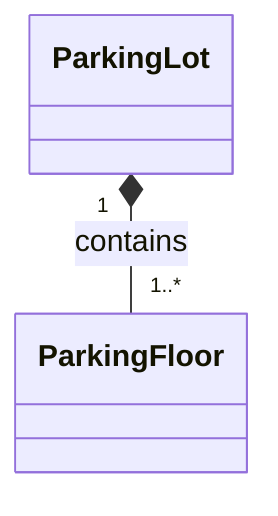

---

5. ==**Dependency** 
==

one class temporarily uses another class to do its work, without necessarily keeping a long-term relationship with it. (if keeping long term relationship it might be aggregation for. example payment gateway integrated inside payment service but gateway can exist alone also that is aggregation but if gateway exist alone and service uses it for payment then cut connection from it that is dependency)


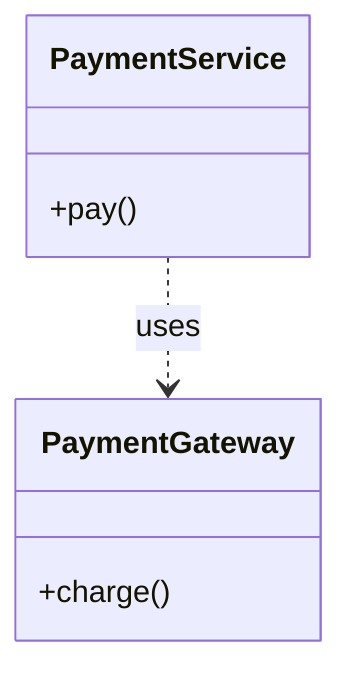

--- -> line is dependency 

---

6. ==**Inheritance (Generalization)**==

one class is a specialized version of another class. car is type of vehicle,  etc. notation -> hollow triangle 

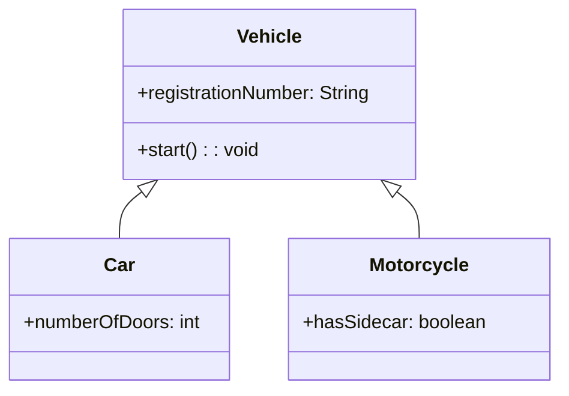

like normal oops inheritance 

--- 

7. ==**Multiplicity (cardinality)**==

how many objects of one class can be associated with an object of another class.

|Notation|Meaning|Example|
|---|---|---|
|`1`|Exactly one|Every floor belongs to one parking lot|
|`0..1`|Zero or one|A spot may have no vehicle or one vehicle|
|`*` or `0..*`|Zero or many|A customer can have zero or many orders|
|`1..*`|One or many|A parking lot has at least one floor|
|`2..5`|Two to five|A team has two to five members|
|`3`|Exactly three|A component has exactly three connectors|

---

8. ==**Example Parking lot with all above terms used** ==


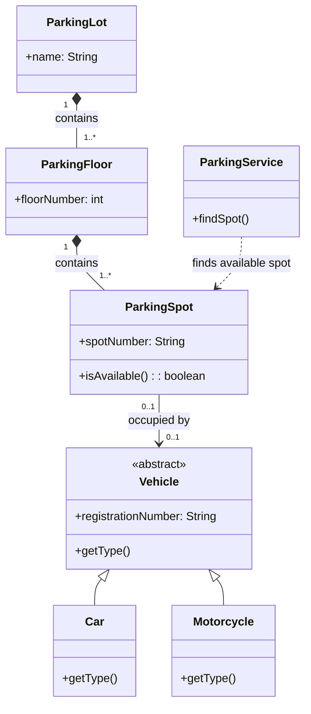


### Sequence Diagrams 

which objects interact with each other, what messages they send, and in what order those interactions happen over time.

1. ==**Basic Structure** ==

- actor -: external entity that interacts with your system.
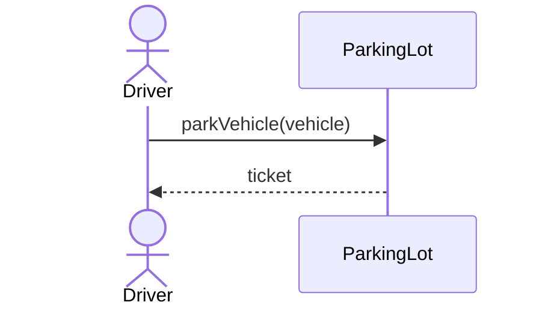


- participants -: represents an object, component, or system that takes part in the interaction.

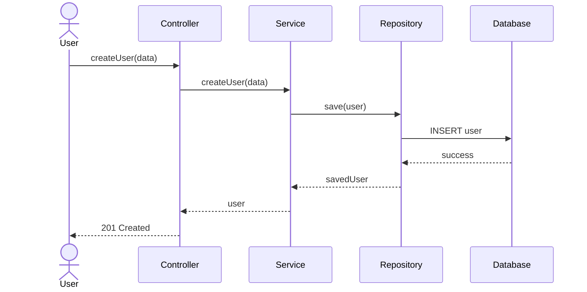

---

2. ==**Lifeline & Activation bar**==

- lifeline -: the vertical dashed line under each participant = that object's life over time (time flows top to bottom).
- activation bar -: the thin box on the lifeline = the object is busy executing a method right now. starts when it receives a call, ends when it returns.

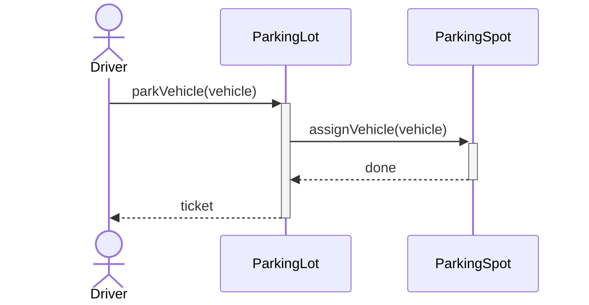

`+` after the arrow = activate, `-` = deactivate (same as writing `activate X` / `deactivate X`)

---

3. ==**Message types (arrows)**==

each arrow type means a different kind of message:

| Message type   | Looks like                   | Meaning                               |
| -------------- | ---------------------------- | ------------------------------------- |
| Synchronous    | solid line, filled arrowhead | caller waits for the answer           |
| Return / reply | dashed line, arrowhead       | answer sent back to the caller        |
| Asynchronous   | solid line, open arrowhead   | fire and forget, caller does not wait |
| Lost / failed  | solid line ending in a cross | message that fails or ends the object |
| Self call      | arrow back to itself         | object calls its own method           |


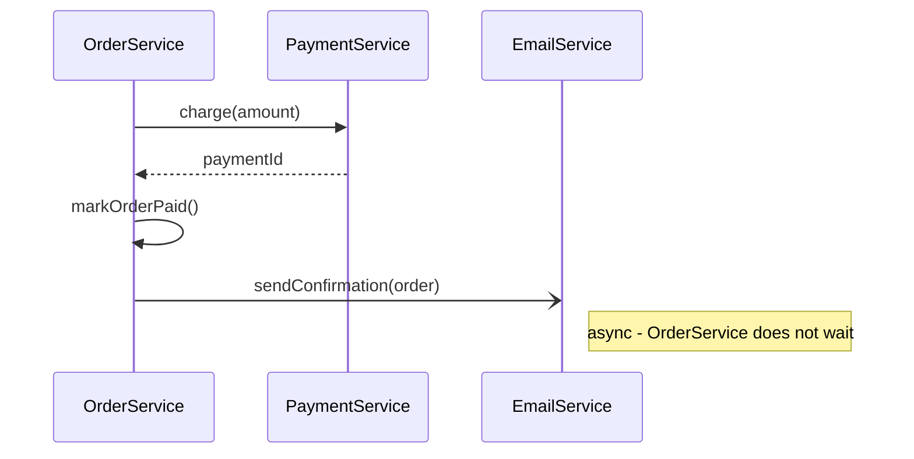

sync vs async -> sync = phone call (you wait on line), async = whatsapp message (send and move on)

---

4. ==**Object creation**==

when an object is created during the flow, show it as a `new` / `create` message to that object (the participant starts from that point).

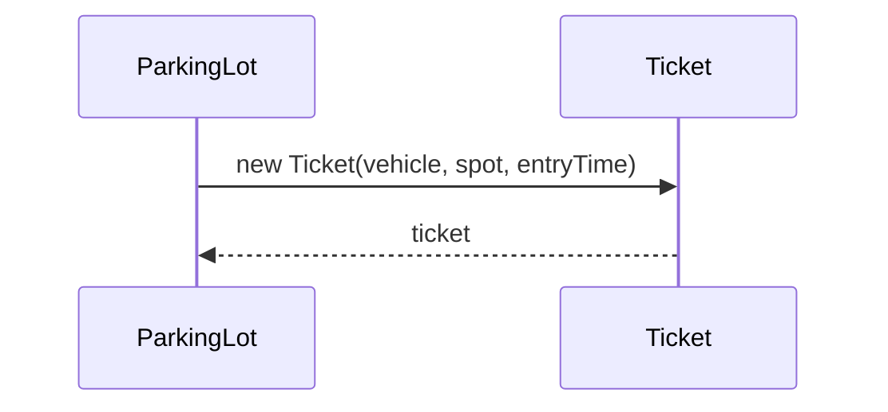

(newer mermaid also supports `create participant Ticket` / `destroy Ticket` keywords - may not render in older Obsidian versions)

---

5. ==**Combined fragments (the boxes)**==

used for conditions, loops, optional steps etc. like `if`, `for`, `try` inside the diagram.

| Fragment       | Code equivalent            | Use when                            |
| -------------- | -------------------------- | ----------------------------------- |
| `alt` + `else` | if - else                  | 2 or more alternate paths           |
| `opt`          | if (without else)          | step happens only if condition true |
| `loop`         | for / while                | repeated messages                   |
| `par` + `and`  | threads / parallel         | things happen at the same time      |
| `break`        | break / throw              | flow stops early (eg. error)        |
| `critical`     | synchronized / transaction | must happen atomically              |

**alt / else** (if - else)

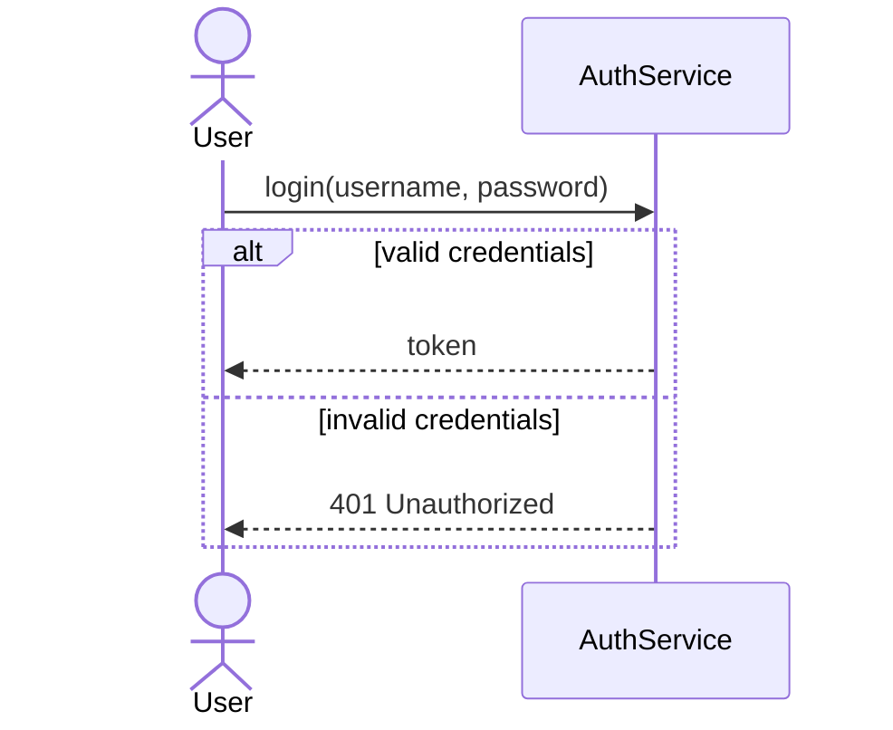

**opt** (optional - only if)

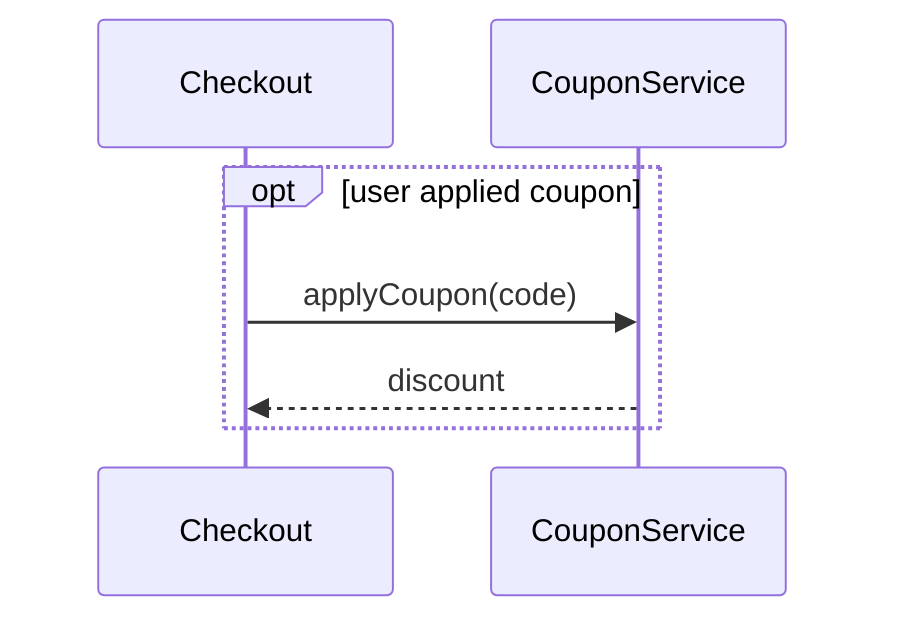

**loop**

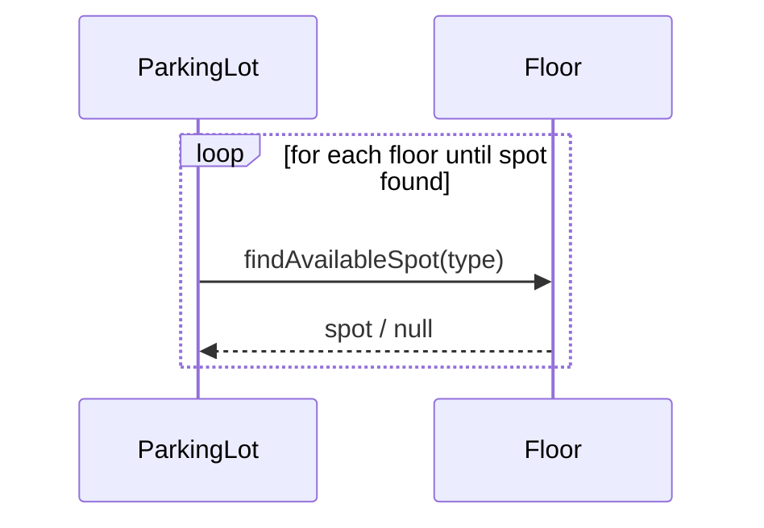

**par** (parallel)

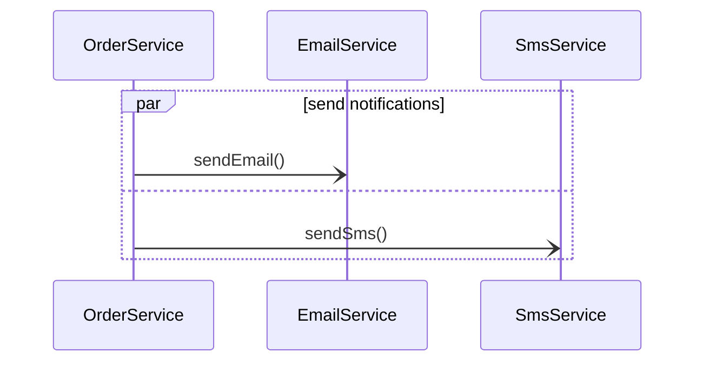

**break** (stop the flow)

```mermaid
sequenceDiagram
    actor User
    participant ATM
    participant Bank

    User->>ATM: withdraw(amount)
    ATM->>Bank: checkBalance()
    Bank-->>ATM: balance
    break balance < amount
        ATM-->>User: Insufficient funds
    end
    ATM-->>User: cash
```

---

6. ==**Notes, numbering & grouping**==

- `Note left of / right of / over A,B : text` -> add explanation
- `autonumber` -> numbers every message (easy to explain in interview "in step 3...")
- `rect rgb(...)` -> highlight a group of messages

```mermaid
sequenceDiagram
    autonumber
    actor Driver
    participant ParkingLot
    participant FeeCalculator

    Driver->>ParkingLot: exitVehicle(ticket)
    Note over Driver,ParkingLot: driver at exit gate
    rect rgba(100, 150, 255, 0.15)
        ParkingLot->>FeeCalculator: calculateFee(ticket)
        FeeCalculator-->>ParkingLot: amount
    end
    ParkingLot-->>Driver: amount to pay
```

---

7. ==**Example Parking lot exit flow with all above terms used**==

```mermaid
sequenceDiagram
    autonumber
    actor Driver
    participant Lot as ParkingLot
    participant Fee as FeeCalculator
    participant Pay as PaymentService
    participant Spot as ParkingSpot
    participant Notify as NotificationService

    Driver->>+Lot: exitVehicle(ticket)
    Lot->>Lot: validateTicket(ticket)

    break ticket invalid / already used
        Lot-->>Driver: Reject - invalid ticket
    end

    Lot->>+Fee: calculateFee(ticket)
    Fee-->>-Lot: amount

    loop max 3 attempts until payment success
        Lot->>+Pay: pay(amount)
        Pay-->>-Lot: success / failed
    end

    alt payment success
        Lot->>+Spot: release()
        Spot-->>-Lot: spot free
        opt driver opted for receipt
            Lot-)Notify: sendReceipt(ticket, amount)
        end
        Lot-->>Driver: Gate opens
    else payment failed after 3 attempts
        Lot-->>Driver: Payment failed - call attendant
    end
    deactivate Lot
```

---

8. ==**Class diagram vs Sequence diagram**==

quick comparison:

| Point     | Class diagram                           | Sequence diagram                                |
| --------- | --------------------------------------- | ----------------------------------------------- |
| Type      | Static (structure)                      | Dynamic (behaviour)                             |
| Answers   | what exists and how it is related       | what happens and in what order                  |
| Shows     | classes, fields, methods, relationships | objects, messages, time order, conditions       |
| Drawn for | whole system                            | one use case / flow at a time (park, exit, pay) |
